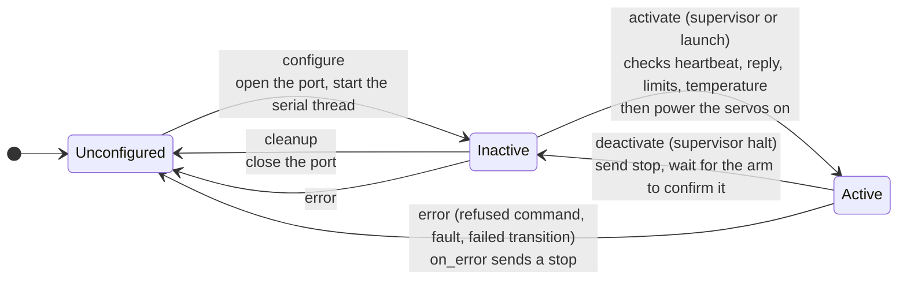
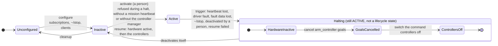

# Lifecycle states

The hardware component (the driver, `positronic_hardware`) and the safety supervisor
(`positronic_safety`) are both lifecycle objects. Each arrow is a transition and what triggers it.

## Hardware component

`supervised.launch.py` starts it **inactive**: the port is open and the pose is published, but
nothing moves until the supervisor activates it.

## Safety supervisor

Any trigger runs the same halt, then the supervisor deactivates itself.

