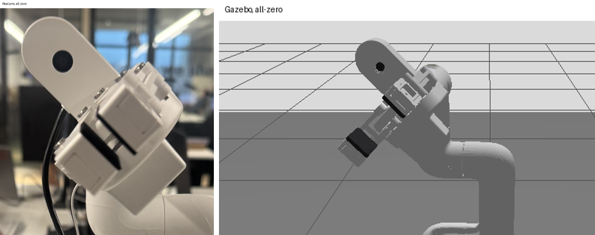
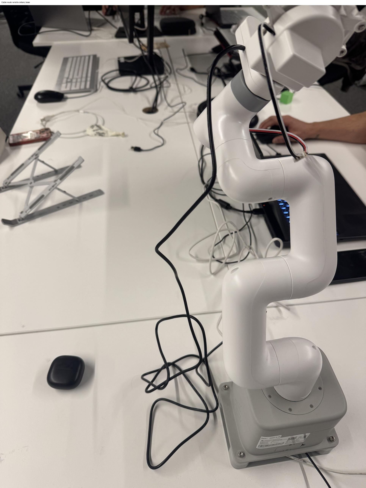
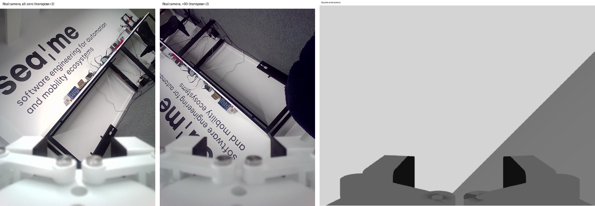
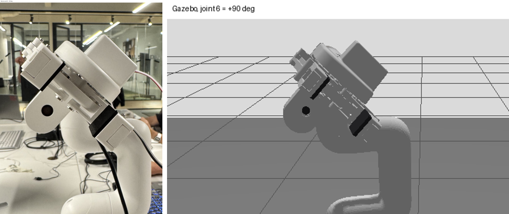

# Evidence: wrist camera mounted on the real arm where the model has it (#97)

## Verdict

PASS. The camera module sits 90 deg from the line the fingers open along, looking into the gap
between them, on the real arm and in the four camera URDFs. Real camera and model camera point
the same way at all-zero and at joint 6 = +90 deg, and the cable reaches +90 deg without
pulling. The Gazebo model keeps its numbers, so the pick of #94 still applies (see below).

| Criterion (#97) | Result | Evidence |
|---|---|---|
| Mounting decided and documented: holes, side, cable route | PASS | [Mounting](#mounting) |
| Cable reaches joint 6 = +90 deg without pulling | PASS | [Real arm and model](#real-arm-and-model) |
| `joint6output_to_camera_flange` matches the mounting, same in the camera variants | PASS | `test_camera_mount.py`, 9 tests |
| Real and model camera point the same way at all-zero and at joint 6 = +90 deg | PASS | [Real arm and model](#real-arm-and-model) |
| Gazebo pick still works, wrist camera sees the cube at pre-grasp | PASS (model unchanged) | [Gazebo pick](#gazebo-pick) |

## Decision

The mount is chosen on the real arm, and it turns out to be the one the Gazebo model already
had (#91):

- The camera module is 90 deg from the line the fingers open along, so it looks into the gap
  between the two jaws and the gripper does not cover the view. It is the position where the
  latches of the camera bracket fit with the gripper mounted as in #94.
- The Gazebo model keeps its numbers, so the pick of #91 and #94 still describes it. The other
  three camera URDFs had the upstream mount and move to the same one.
- Seen from the front (looking at the fingertips) at all-zero, real arm and model agree: camera
  module up and to the left, jaws on the other diagonal.



Note on the earlier records: the comment of #91 in the URDF said the 90 deg mount was "seen on
the real arm on 2026-10-28"; #94 and the first text of #97 said the camera was in line with the
gripper. The mount checked on 2026-11-17, below, is the 90 deg one of #91.

## Mounting

| | |
|---|---|
| Gripper | turned 180 deg on the flange, as in #94 (unchanged) |
| Camera module | 90 deg from the line the fingers open along, looking into the gap between the jaws |
| Side | `-y` of `joint6_flange`. At all-zero the tool points along world `+x` and the flange sits 45 deg turned (#94): seen from the front, the camera module points up and to the left, the jaws sit on the other diagonal |
| Lens to flange | ~5 cm, measured with a ruler (rounded); the model has 41.5 mm (`camera_link`). The ~8 mm gap is not corrected here, see the note below |
| Holes / latches | the latches that come with the arm, clipped into the flange face (the "mouth" of the arm) |
| Cable route | the cable leaves the camera module, runs free down the wrist and plugs straight into the Jetson. Nothing tied; it did not get in the way of any movement |
| Mounted by | Leandro, 2026-11-17 |



Lens distance note: the 5 cm is a rough ruler reading and is not a criterion of #97, which is
about the direction the camera points, not the exact lens position. The model keeps the
manufacturer value (41.5 mm). If a precise number is wanted later, read it from the calibrated
camera image, in its own issue, not from a ruler.

## Image orientation

The raw image of the real camera lies on its side: it is upright once turned 90 deg
counterclockwise (`ffplay`/`ffmpeg ... -vf transpose=2` on `/dev/video0`). Upright here means
the gripper at the bottom of the image, which is what the model gives (`camera_link` roll, #91).

Between all-zero and joint 6 = +90 deg the image content turns 90 deg, because the camera turns
with joint 6. The Gazebo camera turns the same way, so the two match at both poses.



The camera node, still to be written, turns every frame before publishing it
(`cv2.rotate(frame, cv2.ROTATE_90_COUNTERCLOCKWISE)`), and the camera is calibrated on the
turned images, so `camera_info` matches the published image and the frame `camera_link`.

## Model

| File | `joint6output_to_camera_flange` rpy | `camera_flange_to_camera_link` rpy | gripper rpy |
|---|---|---|---|
| `mycobot_280_jn_gripper_camera.urdf` (Gazebo) | `1.5708 0 -1.5708` (unchanged) | `1.5708 0 1.5708` (unchanged) | `1.5708 0 3.1416` (unchanged) |
| `mycobot_280_jn_gripper_camera_no_base.urdf` | `1.5708 0 0` → `1.5708 0 -1.5708` | `0 0 1.5708` → `1.5708 0 1.5708` | `1.5708 0 0` → `1.5708 0 3.1416` |
| `mycobot_280_jn_camera.urdf` | `1.5708 0 0` → `1.5708 0 -1.5708` | `0 0 1.5708` → `1.5708 0 1.5708` | no gripper |
| `mycobot_280_jn_camera_no_base.urdf` | `1.5708 0 0` → `1.5708 0 -1.5708` | `0 0 1.5708` → `1.5708 0 1.5708` | no gripper |

`test_camera_mount.py` keeps the four files equal and at these values, and checks the geometry
behind them: the camera module 90 deg from the fingers, on `-y` of the flange, looking along the
tool axis, with the gripper at the bottom of the image. It also checks that a camera in line
with the fingers and the camera on the other 90 deg side are rejected.

Where the model puts the camera, from the URDF (offset of `camera_link` from the flange origin,
world frame, mm):

| Pose | Offset x, y, z | Camera module |
|---|---|---|
| all-zero | 18.3, -29.3, +29.3 | above the flange, world `-y` side (left, seen from the front) |
| joint 6 = +90 deg | 18.3, -29.3, -29.3 | below the flange, same `-y` side |

## Real arm and model

Safety: joint 6 moved once to +90 deg and back, at speed 30. Bench clear, one person with a hand
on the plug, a second at the laptop. Driver stopped first: only one process can hold the port.

On the Jetson:

```python
from pymycobot import MyCobot280

mc = MyCobot280('/dev/ttyTHS1', 1000000)
mc.send_angles([0, 0, 0, 0, 0, 0], 30)   # photo 1, then check the cable
mc.send_angles([0, 0, 0, 0, 0, 90], 30)  # watch the cable on the way, photo 2
print(mc.get_angles())
mc.send_angles([0, 0, 0, 0, 0, 0], 30)
```

In Gazebo, same two poses (`gazebo.launch.py`, `ROS_DOMAIN_ID` apart from the real arm, then):

```bash
ros2 action send_goal /arm_controller/follow_joint_trajectory \
  control_msgs/action/FollowJointTrajectory \
  "{trajectory: {joint_names: [joint2_to_joint1, joint3_to_joint2, joint4_to_joint3,
    joint5_to_joint4, joint6_to_joint5, joint6output_to_joint6],
    points: [{positions: [0, 0, 0, 0, 0, 1.5708], time_from_start: {sec: 4}}]}}"
```

| Pose | Real arm vs Gazebo | Same way? |
|---|---|---|
| all-zero | [front_zero_real_vs_gazebo.png](figures/front_zero_real_vs_gazebo.png) | yes |
| joint 6 = +90 deg | [front_j6_90_real_vs_gazebo.png](figures/front_j6_90_real_vs_gazebo.png) | yes |



`get_angles()` at +90 deg: `[0.79, -0.52, 0.26, -1.23, 0.52, 89.2]` (joint 6 = 89.2 deg).
Cable at +90 deg: did not pull and did not stretch.

## Gazebo pick

The Gazebo URDF (`mycobot_280_jn_gripper_camera.urdf`) does not change in this issue: only its
comments do, the origins are the same as on `dev` (checked with `git diff`). So the pick of #94
(cube lifted 0.115 m, 0.05 m required) and the wrist camera frames of #91 (cube between the
finger pads at pre-grasp) describe this model unchanged, and the criterion holds without a new
run. A fresh run is optional confirmation; the pick world and script live outside this repo
(#91, "test world kept outside this PR").

## Checks run

| Check | Where | Result |
|---|---|---|
| `test_camera_mount.py` (9 tests), `test_joint6_zero.py`, `test_gazebo_description.py` | `make test` | PASS |
| flake8, pep257 | `make test` | PASS |
| Real arm, two poses (photos, cable, `get_angles`) | the arm | PASS |
| Gazebo, two poses + wrist camera image | laptop | PASS |
| Gazebo pick | model numerically unchanged vs `dev` | #94 applies |
