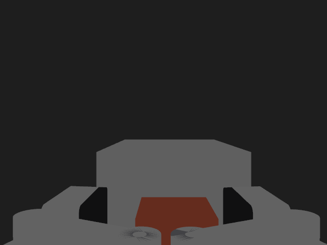
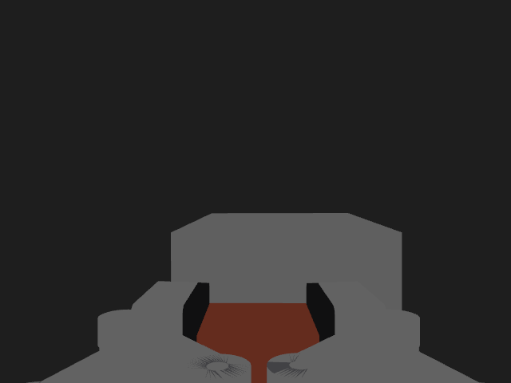
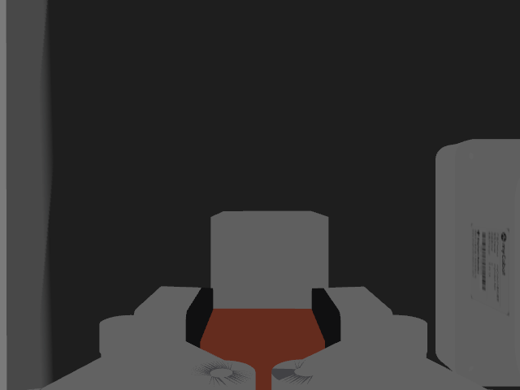

# Evidence: gripper fingers and wrist camera in Gazebo (#91)

## Verdict

| Criterion (#91) | Result | Measured |
|---|---|---|
| The five finger joints are registered as mimic joints | PASS | one "is mimicking joint 'gripper_controller'" line per joint in the Gazebo log |
| A GripperCommand goal moves all six gripper joints with the URDF signs | PASS | goal -0.5: left2 -0.500, left1 +0.500, right3 +0.500, right2 +0.500, right1 -0.500, gripper_controller -0.500 in `/joint_states` |
| `/wrist_camera/image_raw` and `/wrist_camera/camera_info` bridged | PASS | both bridges created, 640x480 at about 8 Hz without a GPU |
| Pytest of the xacro in CI | PASS | `test_gazebo_description`, 4 tests |

## Setup

| | |
|---|---|
| Date | 2026-10-29 |
| Machine | laptop without a GPU, software rendering, `ROS_DOMAIN_ID=66` |
| Launch | `gazebo.launch.py` with the three controllers, then `move_group.launch.py` |
| Object | a 2.5 cm cube on a pedestal in front of the arm, in a test world kept outside this PR |

## Gazebo log

The lines that the fix produces at start, one per finger joint:

```text
Joint 'gripper_base_to_gripper_left2' is mimicking joint 'gripper_controller' with multiplier: 1 and offset: 0
Joint 'gripper_left3_to_gripper_left1' is mimicking joint 'gripper_controller' with multiplier: -1 and offset: 0
Joint 'gripper_base_to_gripper_right3' is mimicking joint 'gripper_controller' with multiplier: -1 and offset: 0
Joint 'gripper_base_to_gripper_right2' is mimicking joint 'gripper_controller' with multiplier: -1 and offset: 0
Joint 'gripper_right3_to_gripper_right1' is mimicking joint 'gripper_controller' with multiplier: 1 and offset: 0
```

Before the fix the same start printed, for the first finger joint, that the physics engine does
not support mimic constraints and no constraint would be created, and only the link of
`gripper_controller` moved.

Bridge, from the same launch:

```text
[ros_gz_bridge]: Creating GZ->ROS Bridge: [/wrist_camera/image_raw (gz.msgs.Image) -> /wrist_camera/image_raw
[ros_gz_bridge]: Creating GZ->ROS Bridge: [/wrist_camera/camera_info (gz.msgs.CameraInfo) -> /wrist_camera/camera_info
```

## Wrist camera frames

Saved from `/wrist_camera/image_raw` while the arm, driven by MoveIt, went down on the cube,
closed the gripper and lifted. With the camera mounted as on the real arm, the image shows both
finger pads at the bottom and the object between them.

| Frame | What it shows |
|---|---|
| `figures/3_at_cube.png` | gripper open around the cube, pedestal behind |
| `figures/4_closed.png` | both fingers closed on the cube, the gripper blocked at -0.35 of the -0.6 asked |
| `figures/5_lifted.png` | cube held, 11 cm above the pedestal |





## Observations

- With the original camera mount (in line with the fingers) the image shows the gripper body
  and little else; the mount in this PR is the one seen on the real arm on 2026-10-28, the sign
  to be confirmed with the gripper mounted and joint 6 at zero.
- Without a GPU the two cameras bring the real-time factor to about 0.2, and the controller
  spawners can time out; activating the controllers by hand works.
