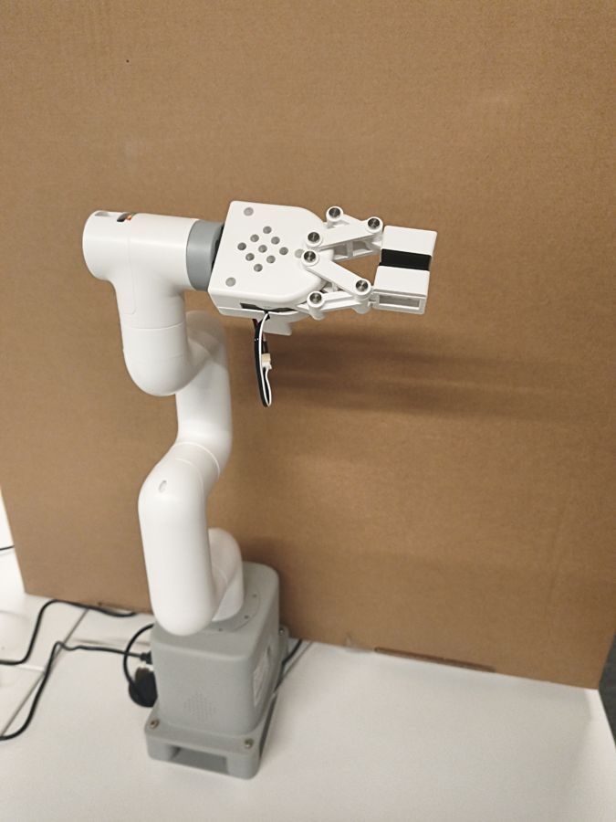
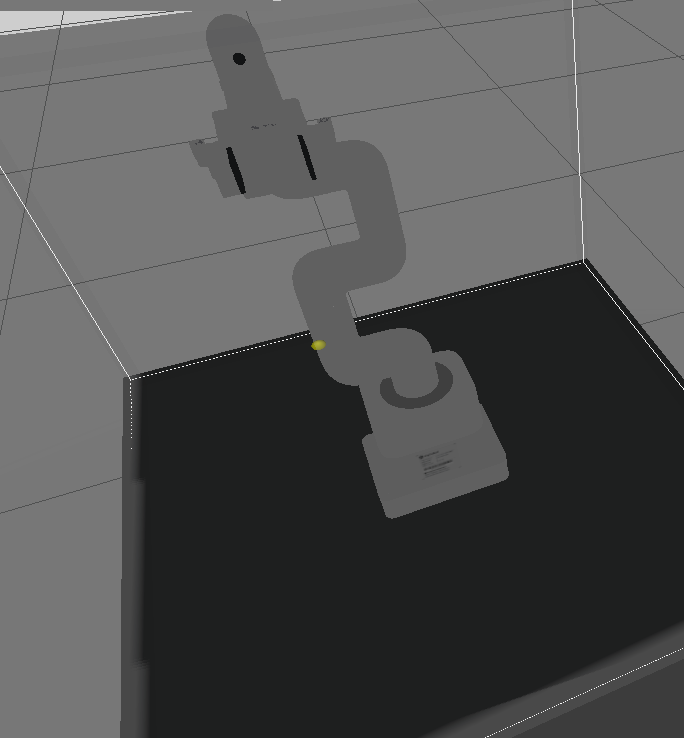
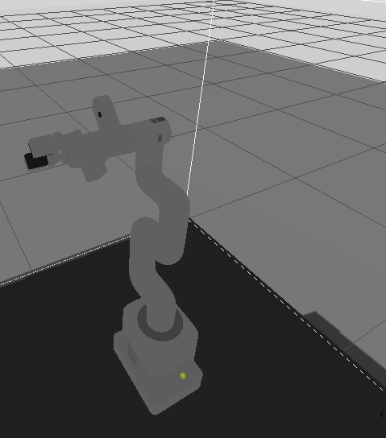
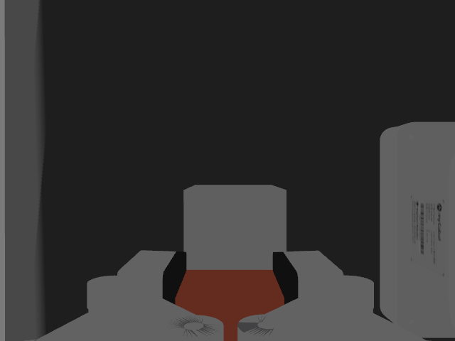

# Evidence: joint 6 zero offset in the URDF (#94)

## Verdict

PASS. With every joint at zero the real flange and gripper sit 45 deg from where the upstream
model drew them. The zero of `joint6output_to_joint6` now carries that offset in the eight
URDFs, the RViz mirror of the real arm matches at zero and at +90 deg, and the Gazebo pick
still lifts the cube.

## Setup

| | |
|---|---|
| Date | 2026-11-03 |
| Arm | myCobot 280 Jetson Nano, gripper mounted, camera off for the measurement |
| Driver | `driver.launch.py` on the Jetson, `mirror.launch.py` on the laptop, `ROS_DOMAIN_ID=17` |
| Simulation | `gazebo.launch.py`, `mycobot_280_jn_gripper_camera.urdf` |

## Measurement

Every joint at zero (`send_angles([0, 0, 0, 0, 0, 0], 30)`), then only joint 6 released
(`release_servo(6)`) and the flange turned by hand until its holes matched the upstream model
at zero, read with `get_angles()`. Then turned away and back, twice.

| Reading | Joint 6 (deg) | Flange |
|---|---|---|
| 1 | -45.79 | matches the upstream model at zero |
| 2 | -0.52 | turned away |
| 3 | -49.30 | matches |
| 4 | 0.08 | turned away |
| 5 | -41.74 | matches |

The flange has a mark at 45 deg from its zero, where the holes form a square: the offset is
the mechanical 45 deg, the spread is the hand alignment. With the gripper mounted, the real
gripper at zero sits 45 deg from the arm's links while the upstream model's was parallel:
flange and gripper are off by the same angle, so the offset is in the zero of the joint, not
in the mounting.

## Change

One line in each of the eight files under `urdf/mycobot_280_jn_sim`, the origin of
`joint6output_to_joint6`: `rpy="-1.5708 0 0"` becomes `rpy="-1.5708 0.7854 0"`. The origin
turns the joint frame by -90 deg about x, so a turn of the zero about the joint axis is a turn
about y before it, the pitch. `test_joint6_zero.py` keeps the eight files equal and at that
value.

## Model and arm at zero

Real arm, Gazebo before the change, Gazebo after it:

The RViz mirror with the real driver, flange only: before the change the holes at zero formed
the square of the upstream mesh, after it they sit as on the real arm
(`figures/rviz_before.png`, `figures/rviz_after.png`). At joint 6 = +90 deg the
mirror followed the arm; the hole pattern repeats every 90 deg, so it looks like zero, and the
direction of the joint was checked in #24.

## Gazebo pick

The pick of the gripper verification (#91) run again on the changed model, same world and
script: pre-grasp and grasp planned, gripper blocked on the object, cube lifted 0.115 m with
0.05 m required (0.114 m on 2026-10-29). The target is a pose of `gripper_base` in the world,
so MoveIt absorbs the new zero in joint 6 and nothing else changes. The camera of the model
sits 90 deg from the gripper, on the real arm it is in line with it: that is #97.

