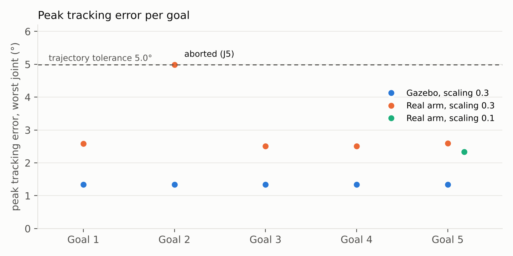
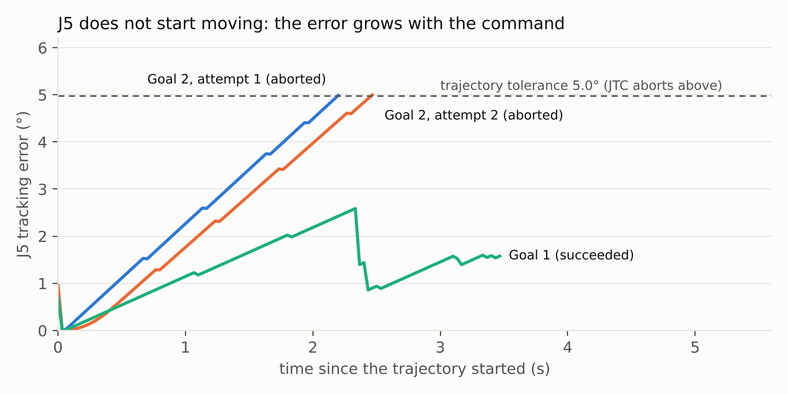

# MoveIt 2 on the real arm: 5 goals in Gazebo, on the fake arm and on the real arm

Verification for the issue "MoveIt 2 plans and executes 5 Cartesian goals on the real arm from RViz".
The same 5 goals were planned and executed from RViz in three batches:

| Batch | Robot side | Where it ran |
|---|---|---|
| Gazebo | `gazebo.launch.py` | laptop |
| Fake arm | `driver.launch.py backend:=fake` | laptop (see [Data notes](#data-notes)) |
| Real arm | `supervised.launch.py` (driver + #45 supervisor) | Jetson; move_group, RViz, mission node and recording on the laptop, wired link |

**Result: 4 of the 5 goals executed on the real arm. Goal 2 did not.** The JTC aborted it twice, both times on
J5 (`joint6_to_joint5`) about 2.2–2.5 s into the motion, at 5.0° tracking error. In Gazebo all 5 goals executed
and MoveIt never cancelled a trajectory at its end.

## Acceptance criteria

| Criterion | Status | Evidence |
|---|---|---|
| MoveIt uses `arm_controller` on hardware | ✅ | `moveit_controllers.yaml`; every real run went through `/arm_controller/follow_joint_trajectory` |
| Real description is the gripper + camera variant; gripper joint at a fixed value until #123 | ✅ | `positronic_real.urdf.xacro` includes `mycobot_280_jn_gripper_camera.urdf`; `positronic_gripper_mock` publishes `gripper_controller` = 0.15 (SRDF "open") |
| Same 5 goals in Gazebo first, same controller name/type and `joint_limits.yaml` | ✅ | 5/5 succeeded; max planned joint velocity 0.078 rad/s in every 0.3 run = 0.26 × 0.3 |
| In Gazebo, with the Jetson JTC tolerances, MoveIt does not cancel at the end | ✅ | No goal ended CANCELED (status 5); executions end at the planned duration, well inside MoveIt's 1.1·T + 1.2 s |
| 5 goals on the arm: MoveIt success and no JTC abort; table; one bag per run with the plan | ⚠️ 4/5 | Goal 2 aborted (status 6) twice on J5; table and bags below |
| 0.26 rad/s in `joint_limits.yaml`, scaling 0.3 | ✅ config / ⏳ #124 | Applied (see plans). #124 has not reported yet; no loop pause was seen during any recorded motion |

## Configuration used

| Setting | Value | Source |
|---|---|---|
| JTC tolerances (Gazebo and Jetson) | trajectory 0.087 rad (5°), goal 0.070 rad (4°), `goal_time` 1.0 s | #33, `jetson_controllers.yaml`, copied to `ros2_controllers.yaml` |
| Controller rate | 30 Hz in both | `jetson_controllers.yaml`, `ros2_controllers.yaml` |
| Joint velocity limit | 0.26 rad/s (15°/s), arm joints | `joint_limits.yaml`, #33 |
| Velocity scaling | 0.3 (one extra run at 0.1, goal 5) | RViz Motion Planning panel |
| `allowed_execution_duration_scaling` | 1.1 | `moveit_controllers.yaml` |
| `allowed_goal_duration_margin` | 1.2 s | `moveit_controllers.yaml` |
| `allowed_start_tolerance` | 0.04 rad (2.3°) | `moveit_controllers.yaml` |
| Start pose of every batch | all joints 0 (SRDF `home`) | |

## The 5 goals

Typed as joint values (degrees) in the RViz Joints tab, so every batch used exactly the same goals. Flange
position is `g_base` → `joint6_flange` from `tf2_echo` after the goal, Gazebo run.

| Goal | J1, J2, J3, J4, J5, J6 (°) | Flange x, y, z (m), Gazebo |
|---|---|---|
| 1 | 110, 50, 50, −30, −30, 60 | 0.163, −0.189, 0.307 |
| 2 | 0, 15, 15, 30, 30, −50 | −0.119, −0.043, 0.449 |
| 3 | −90, −50, 0, 75, 45, 0 | −0.032, −0.155, 0.402 |
| 4 | 120, −80, 65, 100, 0, 60 | 0.023, 0.088, 0.353 |
| 5 | 0, 0, 0, 0, 0, 0 | 0.046, −0.064, 0.468 |

## Results

JTC status: 4 SUCCEEDED, 5 CANCELED, 6 ABORTED. Peak error is the largest |reference − feedback| of any joint
during the motion; final error is the largest one 3 s after the reference stopped. Flange Δ is the distance
from the Gazebo flange position.

| Bag | Goal | Scaling | Duration (s) | MoveIt | JTC | Cancel at end | Peak error (joint) | Final error | Flange Δ |
|---|---|---|---|---|---|---|---|---|---|
| `gazebo_bag1` | 1 | 0.3 | 25.0 | ✅ | 4 | no | 1.34° (J1) | 0.00° | — |
| `gazebo_bag2` | 2 | 0.3 | 25.0 | ✅ | 4 | no | 1.35° (J1) | 0.00° | — |
| `gazebo_bag3` | 3 | 0.3 | 20.6 | ✅ | 4 | no | 1.34° (J1) | 0.00° | — |
| `gazebo_bag4` | 4 | 0.3 | 47.3 | ✅ | 4 | no | 1.35° (J1) | 0.00° | — |
| `gazebo_bag5` | 5 | 0.3 | 27.3 | ✅ | 4 | no | 1.34° (J1) | 0.00° | — |
| `fake_arm_bag1` | 1 | **0.1** | 73.9 | ✅ | 4 | no | 0.00° | 0.00° | 4.5 mm |
| `fake_arm_bag2` | 2 | 0.3 | 24.8 | ✅ | 4 | no | 0.00° | 0.00° | 1.4 mm |
| `fake_arm_bag3` | 3 | 0.3 | 20.2 | ✅ | 4 | no | 0.01° | 0.00° | 1.4 mm |
| `fake_arm_bag4` | 4 | 0.3 | 47.1 | ✅ | 4 | no | 0.01° | 0.00° | 0.0 mm |
| `fake_arm_bag5` | 5 | 0.3 | 27.0 | ✅ | 4 | no | 0.01° | 0.00° | 1.0 mm |
| `real_arm_bag1` | 1 | 0.3 | 24.4 | ✅ | 4 | no | 2.59° (J5) | 1.80° | 12.0 mm |
| `real_arm_bag2` | 2 | 0.3 | aborted at 2.2 | ❌ | **6** | no | **4.99° (J5)** | — | — |
| `real_arm_bag2.5` | 2, retry | 0.3 | aborted at 2.5 | ❌ | **6** | no | **5.00° (J5)** | — | — |
| `real_arm_bag3` | 3 | 0.3 | 20.9 | ✅ | 4 | no | 2.52° (J2) | 1.24° | 7.1 mm |
| `real_arm_bag4` | 4 | 0.3 | 47.0 | ✅ | 4 | no | 2.51° (J1) | 1.20° | 2.2–6.6 mm (3 visits) |
| `real_arm_bag4.5` | 4, repeat | 0.3 | 47.2 | ✅ | 4 | no | 2.56° (J1) | 1.29° | 2.2–6.6 mm (3 visits) |
| `real_arm_bag5` | 5 | **0.1** | 80.3 | ✅ | 4 | no | 2.34° (J4) | 1.24° | 3.3 mm |
| `real_arm_bag5.5` | 5 | 0.3 | 27.0 | ✅ | 4 | no | 2.60° (J4) | 1.29° | 5.5 mm |

MoveIt column: Gazebo and fake from the move_group log. Real arm: from the move_group log for goal 2
(CONTROL_FAILED). For the others it follows from JTC SUCCEEDED with no cancellation. The MoveIt status topic was
not in the bags (see [Data notes](#data-notes)).

After the second abort, pose 2 was reached by hand-planned small moves in RViz, raising J3 first. They are the
last three motions in `real_arm_bag2.5`, all JTC 4. Goals 3–5 then started from pose 2 as in Gazebo.



## Findings

**1. The real arm follows the plan within about 2.6°, except at the start of goal 2.** In the four goals that
executed, the worst joint stayed 2.3–2.6° from the reference, half of the 5° trajectory tolerance. At rest the
joints ended 0.4–1.8° from the goal, inside the 4° goal tolerance and within the 0.5–2.7° resting error measured in
#33. Gazebo shows a constant 1.3° lag on J1 (likely its position gain) and 0 at rest. The fake arm copies each command
into its state, so its error is 0.

**2. Goal 2 fails because J5 does not start moving.** At the start of goal 2 the J5 reading moves less than 0.4°
in 2.2 s while the command moves 4.4°. The error grows linearly until it reaches 5° and the JTC aborts. Both attempts
look the same (0.0871 and 0.0872 rad). The same pattern is visible at the start of goal 1: J5 stays still until the
error reaches 2.6°, then catches up. J2 also stays still for about 1 s at the start of goal 2. This is a
breakaway (deadband) at the start of motion, not lag that grows with speed. From pose 1 (J5 at −30°, carrying the
gripper) J5 needs more than 5° of error before it moves.



**3. Lowering the speed does not reduce the error.** Goal 5 at scaling 0.1 peaked at 2.34° and at 0.3 at 2.60°.
That's three times slower for 0.26° less error. The error is dominated by the servos' static error and breakaway,
not by speed. With these servos, a lower velocity limit is unlikely to make goal 2 pass. At very low speed the
command creeps forward in smaller steps, so it would take even longer for the error to break J5 free.

**4. The real arm is repeatable.** Goal 4 ran twice: peaks 2.51° and 2.56°, final errors within 0.1° of each other,
the same 47 s. Goal 2 aborted twice the same way. The failure is systematic, not random.

**5. Timing matches Gazebo.** Each real execution lasted within 0.6 s of the Gazebo one (24.4 / 25.0, 20.9 / 20.6,
47.0 / 47.3, 27.0 / 27.3 s), and the joints were already inside the 4° goal tolerance when the reference stopped,
so the JTC never needed its 1 s `goal_time`. MoveIt allows
1.1·T + 1.2 s (for example 24.2 s for goal 3, which took 20.9 s). No execution came close to a cancellation.

**6. No control-loop pause during the recorded motions.** In every real bag the controller state arrives every
33 ms (median), with a maximum of 38 ms during motion. The 0.3 s pauses of #124 did not show up in these runs.
The gaps of 0.2–2.4 s at the very start of some bags are from the recording starting, not from the loop.

**7. Flange position vs Gazebo: 2–12 mm** on the real arm, the largest on goal 1 (12 mm). The fake arm is within
4.5 mm: each plan ends a little differently (up to 0.8° per joint between runs).

## Incidents before the recorded runs

These stopped the arm during setup and are kept here because they affect every future run on the arm.

| What | Cause | Fix used |
|---|---|---|
| `Cannot open /dev/ttyTHS1: Device or resource busy` | `driver.launch.py` and `supervised.launch.py` running at the same time; the supervised launch already includes the driver | Run only `supervised.launch.py` on the Jetson |
| Supervisor HALT `HEARTBEAT_LOST` (309 ms, limit 300 ms), arm idle | Wi-Fi between laptop and Jetson: 50 pings had a maximum of 333 ms | Wired link (laptop "Shared to other computers", Jetson `eth0` 10.42.0.15): all pings ≤ 1 ms |
| Supervisor HALT `FAULT_DATA_LOST`: no `driver/fault_code` on `/dynamic_joint_states` for 202 ms (limit 200 ms), arm idle | A stall of the control loop on the Jetson (local, not network). The driver also logs that FIFO realtime scheduling is not permitted | Not fixed; it did not recur during the recorded runs. Input for #124 |
| GoToPose goals reached the mission node that nobody in this session sent | Another session on `ROS_DOMAIN_ID` 17 | Own domain (42) for all runs on the arm |

## Data notes

- **Plans are truncated in the extracted `plan.yaml`.** `ros2 topic echo` cuts arrays at 128 elements, so only the
  first 12.7 s of each plan is in the files. The bags themselves are complete. For #53, extract again with
  `ros2 topic echo --full-length /display_planned_path …`, or read the bag directly with `rosbag2_py`. Planned
  durations in this README are taken from `controller_state`.
- **MoveIt's result is not in the bags.** `/execute_trajectory/_action/status` was recorded but always empty:
  RViz executed through `/move_action`. Record `/move_action/_action/status` in future runs.
- **Velocity scaling.** `fake_arm_bag1` ran at 0.1 (max planned joint velocity 0.026 rad/s), all other runs
  at 0.3 (0.078 rad/s), except `real_arm_bag5`. `real_arm_bag4` was already at 0.3, so `real_arm_bag4.5` is a repeat
  of goal 4, not a correction.
- **The fake batch ran with the driver on the laptop**, so it checked the driver, the gripper mock and the
  procedure, not the laptop ↔ Jetson link. The fake backend copies commands into its state, so it cannot test the
  tolerances either.
- Some `plan.yaml` files hold two plans (an earlier plan still published when the bag started). The last plan is
  the executed one.

## Open questions and options for goal 2

Not decided here; for the team, with the data above.

1. **Driver: compensate the servo breakaway** (e.g. send each target with a small lead in the direction of motion
   at the start of a move). This addresses the cause seen in finding 2. Belongs with #32 / #124.
2. **JTC: per-joint trajectory tolerance for J5.** The JTC supports it, but it changes the #33 values and widens
   how far the arm may drift from the collision-checked path. It needs a team decision.
3. **Planning: avoid the loaded start.** Waypoints, or moving J3 first as done by hand here, reach pose 2. It's a
   workaround, not a fix.
4. **Lowering the velocity limit** is not supported by finding 3. Keep 0.26 rad/s until #124 reports.

## Reproduce

Jetson (`make nano-shell NANO=er@10.42.0.15 ROS_DOMAIN_ID=42`):
`ros2 launch positronic_bringup supervised.launch.py`

Laptop dev container, all terminals on `ROS_DOMAIN_ID=42`:

1. `ros2 launch positronic_moveit_config move_group.launch.py use_sim_time:=false`
2. `ros2 launch positronic_bringup mission.launch.py use_sim_time:=false`, then
   `ros2 lifecycle set /mission_node configure` and `activate`
3. With the bench clear, run `ros2 lifecycle set /safety_supervisor activate`
4. Per goal:
   ```
   ros2 bag record -o real_arm_bagN --include-hidden-topics \
     /joint_states /tf /tf_static /display_planned_path \
     /arm_controller/controller_state \
     /arm_controller/follow_joint_trajectory/_action/status \
     /move_action/_action/status /safety_supervisor/status
   ```
   Then type the goal in the RViz Joints tab, Plan, Execute.

Gazebo: `ros2 launch positronic_bringup gazebo.launch.py` and `move_group.launch.py use_sim_time:=true`.
