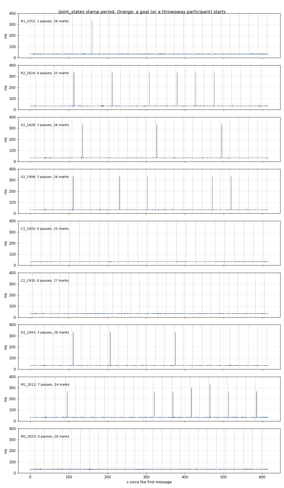

# Evidence: the 0.3 s pauses of `/joint_states` while the JTC executes (#124)

Spike #124: `/joint_states` showed gaps of 0.3 s in the bags of 9 and 10 Nov, while
`arm_controller` was executing trajectories. This file says what the gap is, what it is not,
what triggers it and what it does to the rest of the system. Runs of 2026-11-16 on the Jetson.

## Verdict

**The control loop never pauses. The publication of `/joint_states` does**, for 10 cycles
(333 ms) at a time, and only right after a trajectory goal is sent to `arm_controller` by a
process that creates its action client for that goal (the `ros2 action send_goal` CLI, one new
process per goal). The 10 messages are not late, they are never published: the broadcaster's
`RealtimePublisher` skips the cycle while its publishing thread is still inside the previous
`publish()`, and that `publish()` blocks for about 300 ms inside Fast DDS.

| What was checked | Result |
|---|---|
| The loop (`write()` cadence) during a pause | runs: the next cycle stamp is exactly 10 periods later, and the controller_manager threads run their usual 0.2 ms every 33 ms (thread sampler) |
| CPU, memory, I/O (vmstat), wall clock (reference clock at 10 ms) | clean in every run, no thread waits for CPU |
| Wi-Fi, DDS over the network | not the cause: same pauses with `ROS_AUTOMATIC_DISCOVERY_RANGE=LOCALHOST` (run L) |
| The serial link and the arm | not the cause: same pauses with `backend:=fake` (run F) |
| Discovery of a new DDS participant alone | not the cause: 25 participants came and went, no goal, 0 pauses (run G) |
| Goals from one persistent node, no new endpoints (run H) | **0 pauses in 27 goals**: the trigger is the new action client of each CLI process, not the goal itself |
| Fast DDS asynchronous publishing (run M1) | does not help: 7 pauses in 24 goals, the writer blocks before the send |
| CycloneDDS instead of Fast DDS (run M2) | **0 pauses in 26 goals**, same CLI goals: the block is inside Fast DDS |

## Runs

Same recipe in every run: driver up, `rt_record.py` keeps every `/joint_states` message
(arrival time, cycle stamp), a reference process writes the monotonic and wall clock every
10 ms, `vmstat 1`, `thread_sampler.py` reads `/proc/<pid>/task/*/stat` of `ros2_control_node`
every ~17 ms. 10 min each, then a goal or a participant every ~23 s. Pause = cycle stamp gap
above 100 ms.

| Run | Backend | DDS | What arrives every 23 s | Goals | Pauses | Pause length |
|---|---|---|---|---|---|---|
| A1 15:52 | serial, arm | open (Wi-Fi) | T2 goal from `ros2 action send_goal` | 25 | 1 | 337 ms |
| A2 16:16 | serial, arm | open | same | 25 | 6 | 333 to 334 ms |
| L 18:28 | serial, arm | localhost | same | 26 | 3 | 333 ms |
| F 19:06 | fake | localhost | same | 26 | 5 | 333 to 335 ms |
| G 19:20 | fake | localhost | a throwaway participant (`ros2 node list`), no goal | 0 | 0 | |
| H 19:32 | fake | localhost | T2 goal from one persistent node (`goals_node.py`) | 27 | 0 | |
| F2 19:43 | fake | localhost | same as F, `/dynamic_joint_states` recorded too | 26 | 3 | 333 ms |
| M1 20:12 | fake | localhost, Fast DDS `ASYNCHRONOUS` publish mode | same as F | 24 | 7 | 267 to 333 ms |
| M2 20:25 | fake | localhost, `rmw_cyclonedds_cpp` | same as F | 26 | 0 | |



Every pause of A2, L, F, F2 and M1 sits 3.0 to 3.4 s after a `send_goal` command starts
(orange marks), never elsewhere, and the one pause of A1 sits 4.1 s after one (open Wi-Fi, a
slower CLI start). The CLI takes about 2 s to start, create its action client and send the goal,
so the pause falls within a second of the goal being accepted. Only 1 to 7 goals in 24 to 26
trigger it (table above). (F2 also shows two arrival-only gaps in its first 20 s, stamps intact:
messages delivered late while the recorders were still starting, not the pause.)

## What the pause is

Per pause, in every run: one message arrives 300 to 340 ms late, its cycle stamp is 33 ms after
the previous one (it was produced on time), and the message after it carries a stamp 333 ms
later. So the loop produced every cycle, 10 messages were never published, and one waited.

`joint_state_broadcaster` publishes through `realtime_tools::RealtimePublisher` (3.13.0).
Its `trylock()` returns false while the publishing thread is between taking the message and
finishing `publish()`:

```
bool trylock() { return turn_ == State::REALTIME && msg_mutex_.try_lock(); }
```

A `publish()` that blocks for 300 ms therefore drops the next 9 cycles and delays the one it
was called with. The thread sampler shows exactly that: during the pause no controller_manager
thread is runnable-and-waiting, the loop thread keeps its 33 ms rhythm, and the DDS threads
are idle. The time goes inside the `publish()` call of the broadcaster's thread.

## What triggers it

Run G rules out participant discovery by itself. Run F rules out the serial link. What
remains, common to A1, A2, L and F, is the goal: a new action client (5 endpoints: goal,
cancel and result services, feedback and status topics) matched by the action server of
`arm_controller`, and the goal accepted and executed, both within the same second.
Run H separates the two: 27 goals from one node whose action client exists from the start,
0 pauses. **The trigger is the new action client**: when a `ros2 action send_goal` process
appears, the action server of `arm_controller` matches its five endpoints, and while Fast DDS
does that matching inside the driver process a `publish()` of the broadcaster can wait on it
for about 300 ms. A throwaway participant without action endpoints (run G) does not do it, and
the 5 endpoints of the CLI's own node (rosout, parameters) are the same in G, so what costs
is the matching against the action server, not any discovery.

Why only 1 to 7 goals in 24 to 26: the match happens once per new client, and only a `publish()`
that falls inside that window waits. The window is a few hundred ms in a 23 s cycle.

Two more runs place the block inside Fast DDS. M1 set the writers to `ASYNCHRONOUS` publish
mode through a Fast DDS XML profile (`RMW_FASTRTPS_USE_QOS_FROM_XML=1`): the sending moved to
the `dds.asyn` thread (5 times its usual CPU time) and the pauses stayed, 267 to 333 ms, so the
wait is before the send, when the sample enters the writer. M2 ran the same driver and the
same CLI goals on `rmw_cyclonedds_cpp`: **0 pauses, max stamp period 40.9 ms in 10 min.**

## What it does to the system

- **`arm_controller` is not affected.** The JTC checks its path tolerance on the hardware
  state it reads in the same cycle, not on `/joint_states`. The 10 goals that carried a pause
  on the arm (A1 1, A2 6, L 3) ended `SUCCEEDED`, and no goal of any run was aborted.
- **The supervisor can be.** It feeds its fault watchdog from `/dynamic_joint_states` and halts
  with `FAULT_DATA_LOST` after 200 ms without a usable message. `/dynamic_joint_states` is
  published by the same broadcaster through its own `RealtimePublisher`. Run F2 recorded both topics: **the three
  pauses of `/joint_states` are also pauses of `/dynamic_joint_states`**, same instants, 343 to
  357 ms without a message, 333 ms between stamps. A supervisor in `MONITORING` at that moment
  halts the arm with `FAULT_DATA_LOST` (200 ms), a false halt: safe, but it stops a run.
- **Anyone reading `/joint_states`** (MoveIt's state monitor, RViz, recorders) sees a gap of
  335 to 370 ms, 10 to 11 messages, a few times per 10 min of goals sent this way.

## Recommendation

1. **Nothing to change in the driver.** The loop and the JTC are not involved. The 15 deg/s
   limit and the tolerances of `jetson_controllers.yaml` stay as measured in #33.
2. **Do not send goals to the real arm from a new process per goal** when something watches
   `/joint_states` or `/dynamic_joint_states` with a timeout. The mission node and MoveIt keep
   one action client, so they do not trigger it after they start. Bench scripts that loop
   `ros2 action send_goal` do, and so do the HIL tests if they create a client per test.
3. **Expect one pause when a node with an action client starts** (the mission node, MoveIt's
   `move_group`, RViz). If the supervisor is already `MONITORING` at that moment it
   halts with `FAULT_DATA_LOST`. Two ways out, for the owner of the supervisor to pick: start
   the nodes before the supervisor enters `MONITORING` (the order `supervised.launch.py`
   already uses), or raise `fault_timeout_ms` from 200 (6 messages) to 500 (15 messages), which
   still catches a dead broadcaster within half a second.
4. **A fix exists if one is wanted: CycloneDDS.** `rmw_cyclonedds_cpp` on the Jetson removes
   the pause (run M2). It is a team decision, not a driver one, taken in #142: the RMW is set per process by
   `RMW_IMPLEMENTATION`, the package has to enter the runtime image, and the laptops that talk
   to the Jetson should run the same RMW (the two interoperate on the wire, but mixed setups are
   less tested). Not needed for M1: the pause does not touch motion, and points 2 and 3 cover
   the one reader it affects.

## Limits of the method

- The thread sampler reads `/proc` every ~17 ms: it sees states and run time, not stack
  traces. Where inside Fast DDS `publish()` waits is inferred from what is excluded, not seen.
- Only T2 (joints 1 and 2, 5 deg/s) was used. The pause is not tied to the motion (run F has no
  motion), so other trajectories were not run.
- One Jetson, Fast DDS 2.14.6, rmw_fastrtps_cpp 8.4.4, realtime_tools 3.13.0,
  joint_state_broadcaster 4.42.1.

## Files

| File | What |
|---|---|
| `tools/thread_sampler.py` | per-thread state, wchan and run time of one process from `/proc`, every ~17 ms |
| `tools/pauses_124.py` | finds the pauses in the run folders, prints what happened around each one, draws the figure (`--figure`) |
| `tools/bench/run124.sh` | the runs: A (goals through the CLI), G (throwaway participants, no goal), H (goals from one node) |
| `tools/bench/goals_node.py` | the persistent action client of run H |

`rt_record.py` is the recorder of #39. The 10 ms reference clock and the `/dynamic_joint_states`
recorder of run F2 were one-off checks and are not kept here.
