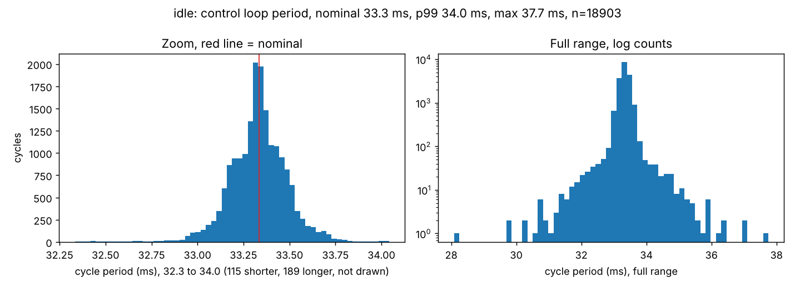
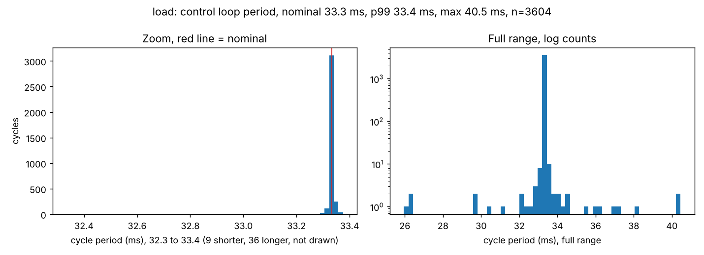

# Evidence: real-time profile of the control loop on the Jetson (#39)

Deliverable "real-time profile, loop period and jitter plotted". It answers one question:
**how regularly does the driver reach the arm, and what happens to that regularity when the
Jetson is busy.** It does not claim a deadline is ever guaranteed; see
[The Linux side is low-latency, not real-time](#the-linux-side-is-low-latency-not-real-time).

## Verdict

Nominal period **33.3 ms** (`update_rate: 30` in `jetson_controllers.yaml`, fixed by #23).
Runs of 2026-11-10, arm powered, driver on `/dev/ttyTHS1`.

| Criterion (#39) | Result |
|---|---|
| Timestamps from `write()` over a 10 minute run: histogram, mean, p99, max | **PASS** mean 33.3 ms, p99 34.0 ms, max 37.7 ms over 18904 cycles |
| Command to motion latency, 20 samples, mean and max | **PASS** mean 191.5 ms, max 200.3 ms over 20 of 20 usable samples |
| Load test: CPU saturated for 2 min, period and jitter against the idle run | **PASS** p99 33.4 ms and max 40.5 ms against 34.0 / 37.7 ms idle, no cycle past 1.5x |
| `rt_profile_v1.md` with the plots and the numbers | this file |
| States clearly that the Linux side is low-latency, not real-time | the section below |

**In one line:** the loop holds 33.3 ms with a p99 of 34.0 ms and no cycle past 1.5x nominal
over ten minutes, and it holds that same period even with all four cores saturated, so the
Linux side is reliably low-latency on this board, though still not real-time (see below).

> The pngs in `figures/` are produced by re-running `analyze_rt.py --figure-dir` on a machine
> with matplotlib: the `positronic-runtime:nano` image has none, so the run printed the ASCII
> histogram instead. Each section below carries that ASCII histogram, which is the same data.

## What a cycle stamp is, and why it is the `write()` period

`write()` is called once per `controller_manager` cycle, after `read()` and after the
controllers' `update()`. `joint_state_broadcaster` publishes once in that same cycle, with
`header.stamp` set to the time the cycle started. So **one `/joint_states` message is one
`write()`**, and the interval between two cycle stamps is the interval between two `write()`
calls. Every period below is measured on those stamps, with no change to the driver.

What this does not give is the offset *inside* a cycle: `write()` runs a few hundred
microseconds after the stamp. That offset is the same every cycle, so it cancels out of every
period, and it is two orders of magnitude below the latency measured in section 2. It is
reported as a known limit, not measured.

Everything after `write()` is a separate stage with its own timing, already measured in #32:
`write()` only stores the command in a lock-free buffer, and the serial thread puts it on the
wire on its next turn, up to `moving_period_ms` (50 ms) later. See
[`../write_sweep/README.md`](../write_sweep/README.md).

## The Linux side is low-latency, not real-time

**Nothing in this stack guarantees a deadline.** The numbers in this file are a measured
distribution, not a bound. The load run makes the point in both directions: the loop held its
period even with all four cores at 100 %, and that is still not a guarantee. What the Jetson
gives is a loop that is usually on time, and that degrades gracefully instead of being
protected:

- **The kernel is not `PREEMPT_RT`.** The Jetson runs the stock L4T kernel
  (<`uname -a` output>), so a higher-priority kernel path can delay the loop for as long as it
  needs, with no upper bound.
- **The loop does not even run at real-time priority.** The container is started without
  `CAP_SYS_NICE` and without an `rtprio` ulimit (`docker/jetson/positronic-driver.service`,
  `make nano-shell`), and `ros2_control_node` says so at start-up: it could not enable the FIFO
  scheduling policy. It runs as an ordinary `SCHED_OTHER` task, competing with everything else
  on the board. The same note is in [#23's
  evidence](../joint_states_rate/joint_states_rate.md).
- **The load run held because of how CFS shares time, not because the loop is protected.** The
  loop sleeps almost the whole cycle and wakes briefly to copy a buffer, so the scheduler gives
  it its slice promptly, and on a 4-core board there is a spare core. Four busy loops are the
  friendliest possible load: all `SCHED_OTHER`, no I/O, no interrupts. A kernel path or a
  higher-priority task would not be shared so fairly, and nothing here bounds that.
- **No CPU is reserved and no memory is locked.** No `isolcpus`, no affinity, no
  `mlockall()`: a page fault or another process on the same core delays the cycle.
- **The link below is not deterministic either.** The arm is reached over a 1 Mbaud serial
  line and answers when its own firmware gets round to it: #32 measured a round trip of 7.7 ms
  at p50 but up to 56.6 ms under a short settle, and stalls where it ignores the port for tens
  of milliseconds after a `send_angles`. The 191 ms command-to-motion latency in section 2 is
  mostly this firmware and the servo's own start, not the Linux loop.
- **So the right claim is soft real-time / low latency.** The loop is designed to stay off the
  critical path rather than to meet a deadline: the serial port lives in its own thread, the
  control loop only copies a lock-free buffer, and a late cycle costs one repeated command,
  not a fault. A missed cycle is a quality-of-service loss, never a safety event, and the
  safety case must not depend on any cycle arriving on time.

A hard real-time version of this would need a `PREEMPT_RT` kernel, the loop at `SCHED_FIFO`
with a reserved core, locked memory, and a bounded transport. None of that is in place, and
#39 does not ask for it.

## Setup

| | |
|---|---|
| Date | 2026-11-10 (Jetson clock) |
| Operator | Leandro Gertrudes |
| Arm | myCobot 280 Jetson Nano |
| Image | `positronic-runtime:nano` (ROS 2 Jazzy) |
| Launch | `ros2 launch positronic_bringup driver.launch.py update_rate:=30` |
| `update_rate` | 30 Hz (nominal period 33.3 ms) |
| Serial timings | `moving_period_ms` 50, `send_settle_ms` 30 (launch defaults) |
| `positronic_arm` component | active for the `steps` run (since #36, `write()` sends nothing while inactive) |
| Commit | <SHA> |
| Run folder | `/ws/log/rt_2026-11-10_1358` (kept by the operator, not committed) |

Safety: the `idle` and `load` runs only subscribe, and no controller that can move the arm is
spawned, so the arm cannot move. The `steps` run moves **joint 1** (index 0, the base) by
0.0873 rad (5 deg) and back, 20 times, at the driver's fixed speed 30, with the bench clear and
a hand on the power. `load` and `steps` are never run together.

## 1. The 10 minute run: `write()` period and jitter

```text
=== idle: 18904 cycles over 630.1 s, nominal 33.3 ms (30 Hz)
  mean rate  30.00 Hz
  cycle      mean 33.3  p50 33.3  p99 34.0  max 37.7 ms at 270.0 s
  arrival    mean 33.3  p50 33.4  p99 37.0  max 93.6 ms
  late 1.5x  0 periods above 50.0 ms
  late 2x    0 periods above 66.7 ms
  histogram of the cycle period:
       28.1 to   28.6 ms  |                                                1
       28.6 to   29.1 ms  |                                                0
       29.1 to   29.6 ms  |                                                0
       29.6 to   30.1 ms  |                                                2
       30.1 to   30.6 ms  |                                                2
       30.6 to   31.1 ms  |                                                10
       31.1 to   31.6 ms  |                                                15
       31.6 to   32.1 ms  |                                                43
       32.1 to   32.6 ms  |                                                99
       32.6 to   33.0 ms  | ##                                             614
       33.0 to   33.5 ms  | ############################################## 16717
       33.5 to   34.0 ms  | ###                                            1211
       34.0 ms and above  | #                                              189
```



| | idle run |
|---|---|
| Cycles | 18904 over 630.1 s |
| Mean rate | 30.00 Hz (nominal 30) |
| Period mean / p50 | 33.3 / 33.3 ms |
| Period p99 | 34.0 ms |
| Period max | 37.7 ms, at 270.0 s into the run |
| Periods above 50.0 ms (1.5x) | 0 |
| Periods above 66.7 ms (2x) | 0 |

A tight peak with a short right tail: 16717 of the 18904 cycles land in the single 33.0 to
33.5 ms bin, and the worst cycle in ten minutes is 37.7 ms, 4.4 ms over nominal. Not one cycle
reaches 1.5x. This matches the #23 read-only run at the same rate (p50 33.3 ms, p99 34.0 ms, max
41.9 ms), and differs from it by having the driver actually write a command every cycle: the
writing adds nothing measurable to the period. The `arrival` max of 93.6 ms is the recorder and
DDS, not the loop (see the note in section "what this does not cover").

## 2. Command to motion latency of the servos

20 commanded steps on joint 1 (index 0), 3 s apart, each 0.0873 rad (5 deg) away from the
previous one. For each step the tool takes the first cycle after the publish as the `write()`
that carried it, then the first later cycle whose stepped joint moved more than 0.0035 rad (two
of the arm's own 0.09 deg reporting steps, so quantisation dither is not read as motion).

```text
=== steps: 2104 cycles over 70.1 s, nominal 33.3 ms (30 Hz)
  mean rate  30.00 Hz
  cycle      mean 33.3  p50 33.3  p99 34.1  max 36.3 ms at 52.2 s
  arrival    mean 33.3  p50 33.4  p99 37.3  max 103.4 ms
  late 1.5x  0 periods above 50.0 ms
  late 2x    0 periods above 66.7 ms
  latency    20 samples of 20 steps, motion threshold 0.0035 rad
    write() to first joint state change   mean 191.5  min 166.4  max 200.3 ms
    publish to first joint state change   mean 216.2  min 192.7  max 229.0 ms
```

| | write() to first joint state change | publish to first joint state change |
|---|---|---|
| Samples | 20 of 20 | 20 of 20 |
| Mean | 191.5 ms | 216.2 ms |
| Min | 166.4 ms | 192.7 ms |
| Max | 200.3 ms | 229.0 ms |

**What this latency is made of**, largest first, for 191.5 ms at the mean:

| Stage | Expected | This run |
|---|---|---|
| The arm's firmware takes the command and the servo ramps from rest to the 0.0035 rad threshold | tens to ~100 ms (not on the Linux side) | **dominant, ~110 ms** |
| Command waits in the serial thread until its next turn | 0 to 50 ms (`moving_period_ms`) | included, up to 50 ms |
| The new position comes back on the next `get_angles` and is published | up to one cycle, 33.3 ms | included |
| `send_angles` on the wire at 1 Mbaud | under 1 ms | included |

The software path (serial wait plus one read-back, at most ~83 ms) cannot account for 191.5 ms,
so the remaining ~110 ms is the arm's own firmware and the physical servo start: the servo
accelerates from rest and only crosses the 0.2 deg threshold some time later. The min-to-max
spread is just 34 ms, one cycle, which confirms the dominant term is a fixed cost in the arm and
the variation is only which cycle caught the motion. **This is the delay a closed loop built on
top of this driver has to live with, and most of it is the arm, not the Jetson.**

## 3. Load test: the same loop with the CPU saturated

All four cores busy for 2 minutes (4 shell busy loops; `stress-ng` is not in the nano image),
arm still, nothing commanded.

```text
=== load: 3605 cycles over 120.1 s, nominal 33.3 ms (30 Hz)
  mean rate  30.00 Hz
  cycle      mean 33.3  p50 33.3  p99 33.4  max 40.5 ms at 60.7 s
  arrival    mean 33.3  p50 33.3  p99 33.8  max 139.0 ms
  late 1.5x  0 periods above 50.0 ms
  late 2x    0 periods above 66.7 ms
  histogram of the cycle period:
       26.0 to   26.6 ms  |                                                3
       26.6 to   27.2 ms  |                                                0
       27.2 to   27.8 ms  |                                                0
       27.8 to   28.4 ms  |                                                0
       28.4 to   29.0 ms  |                                                0
       29.0 to   29.7 ms  |                                                1
       29.7 to   30.3 ms  |                                                1
       30.3 to   30.9 ms  |                                                1
       30.9 to   31.5 ms  |                                                1
       31.5 to   32.1 ms  |                                                1
       32.1 to   32.8 ms  |                                                4
       32.8 to   33.4 ms  | ############################################## 3556
       33.4 ms and above  |                                                36

load tool: 4 shell busy loops (stress-ng not installed)
cores: 4
loadavg at start: 1.26 1.19 0.75
loadavg at end:   4.42 2.51 1.31
cpu busy during the run: 100.0 %
```



| | idle | CPU saturated | change |
|---|---|---|---|
| Cycles / duration | 18904 / 630.1 s | 3605 / 120.1 s | |
| Mean rate | 30.00 Hz | 30.00 Hz | none |
| Period mean | 33.3 ms | 33.3 ms | none |
| Period p99 | 34.0 ms | 33.4 ms | **-0.6 ms** |
| Period max | 37.7 ms | 40.5 ms | **+2.8 ms** |
| Periods above 50.0 ms (1.5x) | 0 | 0 | none |
| Periods above 66.7 ms (2x) | 0 | 0 | none |
| CPU busy during the run | not measured | 100.0 % | |

The loop held. With every core saturated the mean rate stayed at 30.00 Hz, p99 did not grow (it
was 0.6 ms lower than idle, inside the noise), and the worst cycle reached 40.5 ms, still 26 ms
under the serial thread's own 50 ms turn and far from 1.5x. No cycle was late enough to delay a
command reaching the arm. This is the CFS result described above, not a guarantee: the loop
sleeps most of the cycle, so the scheduler returns to it promptly, and the fourth core absorbed
the busy loops. A load that is not plain `SCHED_OTHER` could still preempt it.

The comparison table printed by `analyze_rt.py --report`:

```text
| Run | cycles | duration s | mean ms | p50 ms | p99 ms | max ms | > 50.0 ms | > 66.7 ms |
|---|---|---|---|---|---|---|---|---|
| idle | 18904 | 630.1 | 33.3 | 33.3 | 34.0 | 37.7 | 0 | 0 |
| load | 3605 | 120.1 | 33.3 | 33.3 | 33.4 | 40.5 | 0 | 0 |
| steps | 2104 | 70.1 | 33.3 | 33.3 | 34.1 | 36.3 | 0 | 0 |
```

## What this measurement does not cover

- **Where inside a cycle `write()` runs.** Measured from the cycle stamp, not from `write()`
  itself. Constant per cycle, so it does not affect any period; it would need a change to the
  driver to measure, and #39 does not touch the driver.
- **Stalls on the serial line.** `/joint_states` cannot tell a stall from an arm standing
  still. Those were measured in #32 with `proxy_tap.py` and `tap_stalls.py`; see
  [`../write_sweep/README.md`](../write_sweep/README.md).
- **Anything above 30 Hz.** The rate is fixed by #23 and 50 Hz was already rejected there.
- **The recorder's own cost.** It subscribes and appends a tuple per message, on the same
  board. The `arrival` period reported next to the `cycle` period is the one that carries that
  cost plus DDS (its max was 93.6, 139.0 and 103.4 ms on the three runs); the `cycle` period
  does not, and it is the one every number above is measured on.
- **One session.** Single runs on a single Jetson, on 2026-11-10. No run-to-run spread.

## How to reproduce

Full procedure, safety steps and the analysis command:
[`tools/README.md`](tools/README.md). In short, inside the Jetson container with the driver
running in another shell:

```bash
export OUT=/ws/log/rt_$(date +%Y-%m-%d_%H%M)
bash docs/03_verification/rt_profile/tools/run_rt_profile.sh idle   # 10 min, read-only
bash docs/03_verification/rt_profile/tools/run_rt_profile.sh load   # 2 min, read-only
ros2 run controller_manager spawner forward_position_controller     # bench clear
bash docs/03_verification/rt_profile/tools/run_rt_profile.sh steps  # THE ARM MOVES
python3 docs/03_verification/rt_profile/tools/analyze_rt.py \
  "$OUT"/idle/cycles.csv "$OUT"/load/cycles.csv "$OUT"/steps/cycles.csv \
  --rate 30 --figure-dir docs/03_verification/rt_profile/figures
```

The csv files are not committed; they stay with the operator at <location>. The pngs in
`figures/` and this file are. To get the pngs, re-run that last command on a machine with
matplotlib (the nano image has none).
