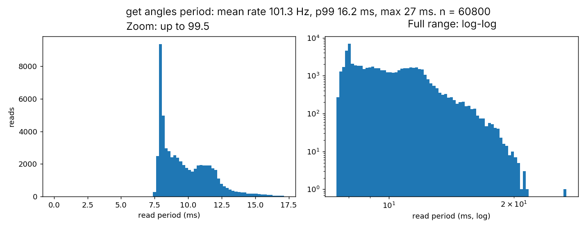

# Serial link measurements: driver update rate and I/O threading

Measured on 2026-10-26 on a myCobot 280 (`MyCobot280`, pymycobot 4.0.4b5) over `/dev/ttyTHS1` at 1,000,000 baud.

## 1. Context

The driver needs a fixed update rate for reading joint angles and for streaming `send_angles` commands. This issue measures what
the serial link actually delivers, so that rate is chosen from numbers instead of guessed:

- how fast `get_angles()` can be called, and how steady that rate is (10 minute read log);
- which `send_angles` streaming rates (16 to 50 Hz) the arm accepts without stalling, in both firmware modes;
- what a write followed by a read costs;
- what the firmware does when the command stream stops mid-motion;
- whether `read()` / `write()` need a dedicated I/O thread.

Conventions used throughout:

- **Fresh mode** is the arm's `set_fresh_mode()` setting. Mode 0 is the default, mode 1 was tested explicitly. Every run set the mode
  and read it back; all read-backs matched the mode in the file name.
- A **stall** is a call that takes more than 450 ms. Stalled calls last about 0.5 s, and the longest ones are close to 1.0 s and 1.5 s,
  which looks like a 0.5 s reply timeout hit once, twice or three times. Calls between 100 and 450 ms do not occur in the write runs,
  so 450 ms is a clean threshold.

## 2. Script and CSV

| What | File |
|---|---|
| Read measurement script | [tools/measure_serial.py](../tools/measure_serial.py) |
| Write streaming script | [tools/py_hz_write.py](../tools/py_hz_write.py) |
| Silence test script | [tools/py_silence.py](../tools/py_silence.py) |

`measure_serial.py` sets the fresh mode, then calls `get_angles()` back to back with no sleep for 600 s, so the loop runs as fast as the
port allows. Each read gets one timestamp row (`t` is the start of the call in seconds since the first read, `duration` is how long the call
took, `valid` is 0 if the reply was not a list of six angles). The read period is the time between the starts of consecutive reads.
Afterwards it runs 200 round trips of `send_angles(current pose)` followed by `get_angles()`. The write re-sends the pose the arm is already
at, so the arm does not move.

`py_hz_write.py` streams `send_angles` on joint 6 on a fixed schedule with no reads, sweeping -30 to +30 degrees in 10 degree steps at
speed 30, for 120 s after a 15 s settle. It logs the intended time, the actual start and the call duration of every write.

## 3. Histogram

The left panel is a linear zoom up to the 99.5th percentile. The right panel shows the full range on log-log axes, so the rare slow reads
stay visible. Fresh mode 1, 60,800 reads over 600.0 s, none invalid.

- The period has a sharp peak just under 8 ms (34% of reads are below 8.5 ms) and a second, broader hump at 10 to 12 ms (34% of reads are
  between 10 and 13 ms). The reads are not one steady value but two groups.
- The tail falls off smoothly to about 21 ms. A single read period reaches 26.8 ms.
- There are no stalls and no isolated outliers in 10 minutes. The slowest read call was 21.4 ms.

| Read period (ms) | Value |
|---|---|
| Mean | 9.87 |
| Standard deviation | 1.96 |
| Min | 7.48 |
| p50 | 9.35 |
| p95 | 13.43 |
| p99 | **16.16** |
| p99.9 | 18.86 |
| Max | **26.79** |
| **Mean rate** | **101.3 Hz** (60,799 periods in 600.0 s) |

| Single `get_angles()` call (ms) | Mean | p50 | p95 | p99 | p99.9 | Max |
|---|---|---|---|---|---|---|
| Read alone, back to back (n = 60,800) | 9.84 | 9.32 | 13.39 | 16.12 | 18.74 | 21.39 |

Round trip of one write plus one read, fresh mode 1, 200 pairs back to back (this is the "one read plus one write" measurement):

| (ms) | Mean | p50 | p99 | Max | Calls over 450 ms |
|---|---|---|---|---|---|
| `send_angles` call | 137.1 | 5.7 | 578.7 | 581.9 | 48 of 200 |
| `get_angles` call | 245.4 | 62.7 | 602.5 | 608.1 | 80 of 200 |
| **Pair (write + read)** | **382.5** | **549.7** | **1133.4** | **1173.1** | **108 of 200 (54%)** |

Only 92 of the 200 pairs had neither call slower than 100 ms, and those clean pairs took a median of 27.6 ms (write about 5.4 ms, read about
22.5 ms). A read that follows a write is therefore about 2.4 times slower than a read in the pure read loop (22.5 ms against 9.3 ms), even
when nothing stalls. 28 pairs stalled only in the write, 60 only in the read and 20 in both. In this tight loop, mixing reads and writes
on the port stalls the link more than half of the time, while 600 s of reads alone never stalled once. This is a worst case
(no spacing between the calls), not a paced stream. See section 7 for what that leaves open.

## 4. Write side

### Modes tested

- **Fresh mode 0** (the arm's default). This is the mode the arm is in unless something sets it.
- **Fresh mode 1**, set explicitly at the start of the run.

Everything else was identical: one `send_angles` per tick on a fixed schedule, joint 6 sweeping between -30 and +30 degrees, 10 degree
steps, speed 30, 120 s per run. "Achieved Hz" is the real rate over the run (writes completed divided by elapsed time); anything below the
target rate is time lost to stalls. Write times are in ms. The p99 excludes the stalled writes, so it shows how the normal calls behave.
The mean includes stalls, which is why it is far above the p50 in runs that stalled. Stall % is stalled writes as a share of writes
completed. `_2`, `_3`... are repeats; `off5ms`, `off10ms`, `off15ms` start the stream that many ms later to shift its phase.

### Fresh mode 1

| Run | Writes | Achieved Hz | Mean | p50 | p99 (no stalls) | Max | Stalls | Stall % |
|---|---|---|---|---|---|---|---|---|
| 16 Hz | 1920 | 16.0 | 9.0 | 9.3 | 11.1 | 19 | 0 | 0.0 |
| 20 Hz | 2400 | 20.0 | 8.7 | 8.8 | 11.2 | 19 | 0 | 0.0 |
| 25 Hz | 3001 | 25.0 | 9.2 | 9.7 | 10.9 | 19 | 0 | 0.0 |
| **30 Hz** | 3601 | 30.0 | 8.8 | 9.1 | 10.6 | 24 | 0 | 0.0 |
| **30 Hz** `_2` | 3601 | 30.0 | 8.6 | 9.0 | 10.8 | 20 | 0 | 0.0 |
| **30 Hz** `_3` | 3601 | 30.0 | 8.6 | 9.2 | 10.6 | 23 | 0 | 0.0 |
| **30 Hz** `_4` | 3601 | 30.0 | 8.7 | 9.1 | 10.6 | 19 | 0 | 0.0 |
| **30 Hz** `_5` | 3601 | 30.0 | 8.7 | 9.1 | 10.6 | 19 | 0 | 0.0 |
| 32 Hz | 3840 | 32.0 | 8.6 | 8.7 | 10.5 | 20 | 0 | 0.0 |
| 35 Hz | 4165 | 34.7 | 8.9 | 8.8 | 13.9 | 531 | 2 | 0.05 |
| 40 Hz | 1647 | 13.7 | 56.8 | 9.0 | 16.6 | 1537 | 140 | 8.5 |
| 40 Hz `_2` | 2567 | 21.5 | 30.3 | 8.5 | 16.5 | 1536 | 101 | 3.9 |
| 40 Hz `_3` | 1586 | 18.9 | 36.5 | 8.4 | 16.3 | 1038 | 83 | 5.2 |
| 40 Hz `_4` | 2567 | 21.4 | 30.3 | 8.4 | 16.5 | 1037 | 100 | 3.9 |
| 40 Hz `_5` | 1395 | 24.8 | 24.0 | 8.4 | 16.6 | 1035 | 39 | 2.8 |
| 50 Hz | 5230 | 43.6 | 10.8 | 8.0 | 10.9 | 1036 | 27 | 0.5 |
| 50 Hz `_2` | 5763 | 48.0 | 9.3 | 8.7 | 10.2 | 586 | 9 | 0.2 |
| 50 Hz `_3` | 5428 | 45.2 | 10.6 | 8.9 | 10.3 | 1031 | 21 | 0.4 |
| 50 Hz `_4` | 5897 | 49.1 | 8.9 | 9.0 | 10.4 | 539 | 4 | 0.1 |
| 50 Hz `_5` | 5534 | 46.3 | 9.8 | 8.9 | 10.4 | 533 | 18 | 0.3 |
| 50 Hz `off5ms` | 6000 | 50.0 | 7.7 | 7.5 | 10.8 | 21 | 0 | 0.0 |
| 50 Hz `off10ms` | 5665 | 47.4 | 9.2 | 7.5 | 11.1 | 585 | 13 | 0.2 |
| 50 Hz `off15ms` | 5946 | 49.5 | 8.3 | 8.5 | 10.4 | 583 | 2 | 0.0 |

Summary per rate, fresh mode 1:

| Rate | Runs | Achieved Hz (range) | Stall % (range) | Verdict |
|---|---|---|---|---|
| 16, 20, 25, 32 Hz | 1 each | exactly the target | 0 | clean, but a single run each |
| **30 Hz** | **5** | **30.0 in all 5** | **0 in all 5** | **clean and reproducible** |
| 35 Hz | 1 | 34.7 | 0.05 (2 stalls) | nearly clean, one run |
| 40 Hz | 5 | 13.7 to 24.8 | 2.8 to 8.5 | **bad in 5 of 5 runs** |
| 50 Hz | 8 (5 plain, 3 with offsets) | 43.6 to 50.0 (mean 47.4) | 0 to 0.5 | mostly good, some stalls |

In the clean runs the normal write call takes about 9 ms (p50) and never more than 24 ms, and the schedule keeps time (lateness p99 below
0.6 ms in every run). At 50 Hz the stalls come in bursts, not evenly. In the first 50 Hz run they all fall between 0.8 s and 39 s and
the last 80 s are clean. With a 10 ms offset the first 66 s are clean and the stalls start after that. Inside a burst they recur every 5
to 7 writes.

### Fresh mode 0

| Run | Writes | Achieved Hz | Mean | p50 | p99 (no stalls) | Max | Stalls | Stall % |
|---|---|---|---|---|---|---|---|---|
| 16 Hz | 576 | 4.8 | 153.5 | 7.4 | 16.1 | 1506 | 140 | 24.3 |
| 20 Hz | 2220 | 18.5 | 12.8 | 8.9 | 11.0 | 1013 | 15 | 0.7 |
| 20 Hz `_2` | 2330 | 19.4 | 10.2 | 8.7 | 11.0 | 512 | 8 | 0.3 |
| 20 Hz `_3` | 789 | 6.6 | 112.1 | 10.1 | 16.0 | 1505 | 140 | 17.7 |
| 20 Hz `_4` | 1568 | 13.1 | 35.8 | 8.7 | 15.9 | 1506 | 75 | 4.8 |
| 25 Hz | 1274 | 10.6 | 64.4 | 9.6 | 13.0 | 548 | 138 | 10.8 |
| 30 Hz | 736 | 6.1 | 136.3 | 5.7 | 13.6 | 1505 | 173 | 23.5 |
| 32 Hz | 752 | 6.3 | 134.6 | 5.7 | 11.1 | 1514 | 167 | 22.2 |
| 35 Hz | 783 | 6.5 | 134.7 | 5.7 | 13.0 | 1012 | 185 | 23.6 |
| 40 Hz | 566 | 4.7 | 193.8 | 6.6 | 13.2 | 1504 | 176 | 31.1 |
| 50 Hz | 5551 | 46.3 | 9.8 | 9.0 | 10.2 | 1014 | 17 | 0.3 |
| 50 Hz `_2` | 4725 | 39.4 | 12.9 | 7.9 | 10.4 | 1008 | 50 | 1.1 |
| 50 Hz `_3` | 3650 | 30.5 | 20.8 | 8.9 | 10.4 | 1012 | 84 | 2.3 |
| 50 Hz `_4` | 2974 | 24.9 | 27.7 | 7.9 | 10.0 | 1504 | 102 | 3.4 |
| 50 Hz `off5ms` | 2618 | 21.9 | 34.0 | 9.1 | 10.5 | 1507 | 106 | 4.0 |
| 50 Hz `off10ms` | 5365 | 44.8 | 10.4 | 7.8 | 10.3 | 515 | 26 | 0.5 |
| 50 Hz `off15ms` | 5726 | 47.7 | 8.8 | 7.7 | 10.2 | 1012 | 9 | 0.2 |

Fresh mode 0 is not usable as a streaming mode. Outside 20 Hz and 50 Hz it collapses to 5 to 10 Hz with 11 to 31% stalls. The two rates that
look fine on their first run do not hold up on repeats: 20 Hz gave 18.5, 19.4, 6.6 and 13.1 Hz, and 50 Hz gave 46.3, 39.4, 30.5 and 24.9 Hz,
getting worse run after run. The same rate can give good and bad results in the same mode, so a rate that worked once in mode 0 means little.
The 50 Hz run with a 5 ms offset also collapsed in mode 0 (21.9 Hz) and was perfect in mode 1 (50.0 Hz).

### Smoothness

The motion looked smooth while streaming. This was only tested on joint 6, so it is not possible to reach a definitive conclusion about
smoothness of the arm as a whole. It was not measured (no video analysis or IMU), so this is an observation only.

## 5. Silence

The test streams a ramp on joint 6, stops sending after a random number of writes while the arm is still moving, and does not call `stop()`. It then reads the arm for 6 s. Trials alternate direction. `lag at cut` is how far the arm was from the last commanded target when the stream stopped. The `final` position is the median of the last readings. `py_silence.py` produced both runs.

| Run | Rate | Step | Commanded speed | Fresh mode | Trials |
|---|---|---|---|---|---|
| **A (proposed operating point)** | 30 Hz | 5° | 150°/s | 1 | 10 |
| B (earlier run) | 50 Hz | 2° | 100°/s | 0 and 1 | 10 each |

The step is chosen so the commanded speed is far above what the arm can follow. Then the arm is well behind the target when the stream stops, and the trial can tell the outcomes apart.

Classes: **finished** = the arm ends at the last commanded target; **held** = it stops where it was at the cut; **kept going** = it ends past the target; **ambiguous** = the first reading after the cut already shows the arm at its final position, so the trial cannot tell the cases apart (lag under 4 degrees); **discarded** = a write stalled (over 450 ms) during the stream, so the cut moment is unreliable.

### 5.1 Run A: 30 Hz, fresh mode 1

| Trial | Dir | Writes | Last target | At cut | Lag at cut | Final | Final minus target | Class |
|---|---|---|---|---|---|---|---|---|
| 0 | + | 7 | 5.0 | -25.0 | 30.0 | 4.4 | -0.6 | **finished** |
| 1 | - | 7 | -5.0 | 26.3 | 31.3 | -4.3 | +0.7 | **finished** |
| 2 | + | 7 | 5.0 | -25.0 | 30.0 | 4.4 | -0.6 | **finished** |
| 3 | - | 4 | 10.0 | 10.6 | 0.6 | 10.6 | +0.6 | ambiguous |
| 4 | + | 8 | 10.0 | -24.6 | 34.6 | 9.4 | -0.6 | **finished** |
| 5 | - | 3 | 15.0 | 29.4 | 14.4 | 15.6 | +0.6 | **finished** |
| 6 | + | 8 | 10.0 | -24.3 | 34.3 | 9.4 | -0.6 | **finished** |
| 7 | - | 7 | -5.0 | 25.0 | 30.0 | -4.3 | +0.7 | **finished** |
| 8 | + | 4 | -10.0 | -29.4 | 19.4 | -10.5 | -0.5 | **finished** |
| 9 | - | 6 | 0.0 | 3.5 | 3.5 | 0.6 | +0.6 | ambiguous |

Result: **8 finished, 2 ambiguous, 0 discarded.** No write stalled (the slowest write was 3.0 ms).

### 5.2 Run B: 50 Hz, fresh modes 0 and 1

Fresh mode 0:

| Trial | Dir | Writes | Last target | At cut | Lag at cut | Final | Final minus target | Class |
|---|---|---|---|---|---|---|---|---|
| 0 | + | 19 | 8.0 | -19.9 | 27.9 | 7.5 | -0.5 | discarded |
| 1 | - | 13 | 4.0 | 28.7 | 24.7 | 4.7 | +0.7 | **finished** |
| 2 | + | 9 | -12.0 | -29.4 | 17.4 | -12.6 | -0.6 | **finished** |
| 3 | - | 20 | -10.0 | 26.9 | 36.9 | -9.3 | +0.7 | **finished** |
| 4 | + | 17 | 4.0 | -14.6 | 18.6 | 3.4 | -0.6 | discarded |
| 5 | - | 8 | 14.0 | 14.7 | 0.7 | 14.7 | +0.7 | discarded |
| 6 | + | 18 | 6.0 | -27.3 | 33.3 | 5.4 | -0.6 | **finished** |
| 7 | - | 16 | -2.0 | 29.4 | 31.4 | -1.3 | +0.7 | **finished** |
| 8 | + | 11 | -8.0 | -29.3 | 21.3 | -8.6 | -0.6 | **finished** |
| 9 | - | 21 | -12.0 | 3.3 | 15.3 | -11.3 | +0.7 | discarded |

Fresh mode 1:

| Trial | Dir | Writes | Last target | At cut | Lag at cut | Final | Final minus target | Class |
|---|---|---|---|---|---|---|---|---|
| 0 | + | 13 | -4.0 | -8.6 | 4.6 | -4.6 | -0.6 | discarded |
| 1 | - | 19 | -8.0 | 18.1 | 26.1 | -7.4 | +0.6 | **finished** |
| 2 | + | 11 | -8.0 | -8.6 | 0.6 | -8.6 | -0.6 | discarded |
| 3 | - | 14 | 2.0 | 2.7 | 0.7 | 2.6 | +0.6 | ambiguous |
| 4 | + | 8 | -14.0 | -14.6 | 0.6 | -14.6 | -0.6 | ambiguous |
| 5 | - | 21 | -12.0 | 15.8 | 27.8 | -9.3 | **+2.7** | partway |
| 6 | + | 18 | 6.0 | -18.8 | 24.8 | 5.4 | -0.6 | **finished** |
| 7 | - | 11 | 8.0 | 25.0 | 17.0 | 8.7 | +0.7 | **finished** |
| 8 | + | 15 | 0.0 | -0.6 | 0.6 | -0.6 | -0.6 | discarded |
| 9 | - | 8 | 14.0 | 14.7 | 0.7 | 14.7 | +0.7 | discarded |

Result: in mode 0, 6 finished and 4 discarded. In mode 1, 3 finished, 1 partway, 2 ambiguous and 4 discarded.

### 5.3 What the arm did

- **It carries on and finishes the motion.** In all 17 trials where the arm was still far from the target (8 at 30 Hz, 9 at 50 Hz), it kept moving after the stream stopped and ended at the last commanded target. It was 14 to 37 degrees away at the cut. It never held its position and never waited for a stop command.
- **It did not overshoot.** The arm stopped 0.5 to 0.7 degrees *short* of the last target in every finished trial, always on the side it approached from. The highest reading beyond the target was never above -0.5 degrees. The constant offset looks like the arm's own stopping tolerance.
- **One trial stopped well short.** At 50 Hz in mode 1, trial 5 stopped at -9.3°, 2.7° short of -12°. The 20th write of that stream commanded -10, so the arm ended near that command and not the last one. It did not repeat in 10 trials at 30 Hz, and one trial cannot confirm a dropped write.
- **Speed after the cut.** In mode 0 the arm covered the remaining distance at about 9 to 10°/s. In mode 1 it moved at about 46°/s in the one trace with no gap (run A, trial 4, 34° in about 0.73 s). That points to the arm replaying queued commands at their own pace in mode 0, and going straight to the newest one in mode 1. That is an interpretation of the timing, not something the data proves.
- **The first read after the last write stalls.** In 9 of 10 trials at 30 Hz, the first read after the final write took about 0.5 s (a gap of 0.52 to 0.57 s between the first two readings, or a first reading that only arrives at 0.52 s). The same happens at 50 Hz in both modes. So after the stream stops, the driver cannot see the arm's state for about 0.5 s. This is the write-then-read stall from section 3, seen again with no write stalls at all.
  - Settling times are therefore not reported. In mode 1 they would include that 0.5 s of silence, so they only show that the arm had finished by the time the read returned.
  - It is also why trials 3 and 9 at 30 Hz are "ambiguous": the arm had already caught up before the first reading arrived.
- **Sample size.** Run A: 8 informative, 2 ambiguous and 0 discarded out of 10. Run B: 20 trials, 9 informative, 2 ambiguous and 8 discarded because a write stalled mid-stream. The result is consistent but based on a small number of trials.

Consequence for the driver: **stopping the command stream does not stop the arm.** It will finish the move to the last target. A real stop needs an explicit `stop()` (and, for an emergency stop, a hardware cut). This test also gives no latency for `stop()`.

## 6. Rate proposed

**Write (command) rate: 30 Hz, with fresh mode 1 set and read back at connect.**

Why 30 Hz:

- It is the only rate with a full set of repeats that were all clean: 5 runs, each exactly 30.0 Hz, 0 stalls in 18,005 writes in total.
- It leaves room. The normal write call takes about 9 ms (p99 10.8 ms), a third of the 33 ms period.
- 16 to 32 Hz were all clean in mode 1, so a small drift in the rate will not push it into a bad region.

Why not the neighbours:

- **50 Hz** is not rejected, but it is not the safe default. In mode 1 it averaged 47.4 Hz (43.6 to 50.0) with 0 to 0.5% stalls, and the stalls come in bursts that lose about 0.5 s each. It can be used if the application needs it and tolerates short gaps.
- **About 40 Hz** should be avoided. It failed in 5 of 5 runs (13.7 to 24.8 Hz achieved).
- **Mode 0** should not be used for streaming at any rate.

**Read (state) rate:** reads alone run at 101 Hz with p99 16 ms and no stalls in 10 minutes, so the port can read much faster than any control loop needs. But reads mixed with writes stalled in 54% of tight write + read pairs. The read rate that is safe while a 30 Hz write stream is running was not measured, so no specific rate is proposed here. Until it is measured, the driver should read at a low rate and treat any call over 450 ms as a stall.

**Port ownership: required.** Reads and writes share one serial port, and the stalls appear when they are mixed. That test was run sequentially in a single thread, so the stalls do not come from concurrency. They come from a write followed by a read on this link. The driver therefore needs **one owner of the port** that issues every call in order, and no other code may touch the port:

- A scheduler sends the writes on a fixed schedule (`next += period`) and places a read only in chosen gaps, at a limited rate.
- Two threads on the same port (one for reads, one for writes) are **not** recommended. They would let calls overlap, and the library waits for a reply after each command, so one call could take the other's reply or time out. If more than one caller needs the port, a lock around it only brings back the one-call-at-a-time order of a single owner.

**Dedicated I/O thread: recommended, not required.** Any call can block for about 0.5 s (up to about 1.5 s was seen). A scheduler running in the main thread would freeze the whole program during each stall, including any stop request waiting behind it.

- **A dedicated thread is not needed if** the program only drives the arm and can tolerate a pause of up to 1.5 s.
- **A dedicated thread is needed if** anything else must keep running through a stall, such as monitoring, another interface or an emergency stop path. The scheduler then runs in one I/O thread, and the rest of the program talks to it through a mailbox where the latest command wins, and reads the latest state with its timestamp.
- The thread contains the stalls but does not remove them. The driver must tolerate a gap of 0.5 to 1.5 s in both commands and state, and expose the age of the last state so the control side can see it is stale.

A single-threaded driver against a threaded one was not measured, the recommendation comes from the blocking times above, not from a direct comparison.

## 7. Anything else

**Not measured / limitations**

- **Interleaved read rate.** The write + read test was a tight loop with no spacing. A 30 Hz write stream with a read every N-th tick was not
  tested, so the usable read rate alongside the stream is open.
- **Repeats.** Only 30, 40 and 50 Hz in mode 1 have several runs. The other rates (16, 20, 25, 32, 35 Hz) are single runs.
- **Why stalls come in bursts** at 50 Hz (and why they start and stop) is not explained. A rate that is clean for one run can stall in another.
- **Fresh mode persistence.** It is not known whether the arm keeps the mode after a power cycle. Setting and reading it back at every
  connect avoids depending on that. Mode 0 results drifted from run to run, so the arm's state before a run clearly matters.
- **Smoothness** was not evaluated (section 4).
- **Emergency stop.** The silence test shows the stream going quiet does not stop the arm. How fast `stop()` acts, in either mode, was not measured.
- Servo temperatures at the end of the read test were 32 to 39 degrees C.

**Driver implications**

1. Set fresh mode 1 on connect and read it back; fail loudly if it is not 1.
2. One I/O thread owns the port; the control side posts the latest command (latest wins) and reads the latest state with its timestamp.
3. Treat any call over 450 ms as a stall, log it, and keep running.
4. Never rely on silence to stop the arm; send `stop()` explicitly.

