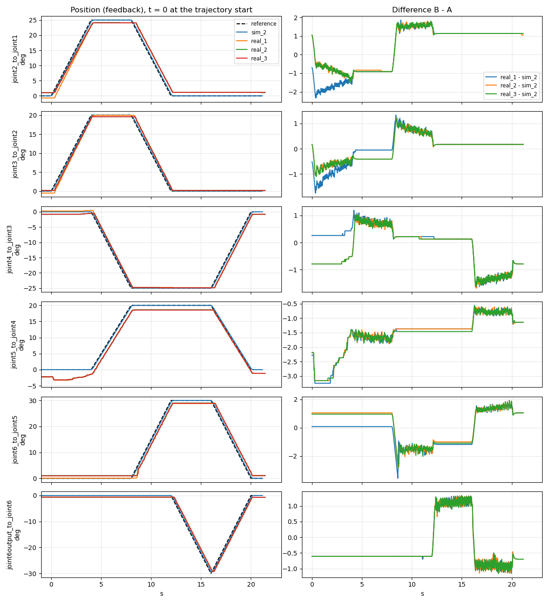

# Sim-to-real report v1: one trajectory in Gazebo and on the real arm (#37)

## Verdict

**The real arm follows the same trajectory within 3.6 deg of Gazebo on every joint**, RMS at
most 1.7 deg (worst joint `joint6_to_joint5` for the max, `joint5_to_joint4` for the RMS). All
three real runs ended in `SUCCEEDED`, inside `arm_controller`'s 5 deg trajectory tolerance.

The gap is mostly **static**, not a lag, and Gazebo models none of it:

- **The arm stops 1 to 1.5 deg short of every target**, in the direction it was moving, and
  holds there. Gazebo reaches every target exactly.
- **`joint5_to_joint4` sits 1.5 deg low for the whole run** (signed mean -1.55 deg), and drifts
  by 1 deg when joints 1 and 2 move, without being commanded.

Both are larger than the arm's own spread between runs with the same history (real vs real,
below), so they are model error, not noise. Gazebo itself repeats to 0.01 deg.

## Results

All numbers in degrees, from `compare_runs.py`. "Noise floor" is the spread between runs of the
same world: a sim-to-real gap only means something where it is larger than that spread.

### Real vs sim (feedback, real - sim)

`compare_runs.py runs/sim_2 runs/real_1 runs/real_2 runs/real_3`. Max abs is the worst of the
three runs; the other columns give the range over the three.

| Joint | max abs | mean abs | signed mean | RMS | final abs | real vs real, max abs |
|---|---:|---:|---:|---:|---:|---:|
| joint2_to_joint1 | 2.33 | 1.09 to 1.26 | 0.26 to 0.45 | 1.13 to 1.31 | 1.05 to 1.14 | 1.84 |
| joint3_to_joint2 | 1.75 | 0.40 to 0.41 | 0.02 | 0.47 to 0.57 | 0.17 | 0.76 |
| joint4_to_joint3 | 1.68 | 0.55 to 0.62 | -0.01 to -0.23 | 0.71 to 0.76 | 0.79 | 1.13 |
| joint5_to_joint4 | **3.25** | **1.54 to 1.58** | **-1.54 to -1.58** | **1.67 to 1.70** | 1.14 | 0.35 |
| joint6_to_joint5 | **3.57** | 0.85 to 1.17 | -0.19 to 0.24 | 1.07 to 1.21 | 1.05 | 1.58 |
| joint6output_to_joint6 | 1.33 | 0.74 to 0.75 | -0.34 | 0.77 | 0.70 | 0.40 |

### Noise floor of the arm (real vs real)

`compare_runs.py runs/real_1 runs/real_2 runs/real_3`, worst of the two pairs:

| Joint | max abs | mean abs | signed mean | RMS | final abs |
|---|---:|---:|---:|---:|---:|
| joint2_to_joint1 | 1.84 | 0.20 | 0.19 | 0.47 | 0.09 |
| joint3_to_joint2 | 0.76 | 0.15 | -0.00 | 0.25 | 0.00 |
| joint4_to_joint3 | 1.13 | 0.24 | -0.22 | 0.47 | 0.00 |
| joint5_to_joint4 | 0.35 | 0.06 | 0.01 | 0.08 | 0.00 |
| joint6_to_joint5 | 1.58 | 0.47 | 0.42 | 0.63 | 0.00 |
| joint6output_to_joint6 | 0.40 | 0.02 | -0.00 | 0.06 | 0.00 |

The larger values come from the first seconds and from `real_1` only: `real_2` and `real_3`
overlap within the 0.2 deg servo noise for the whole run, and all three end on the same pose
(final abs 0.00 to 0.09). `real_1` started from the pose the first move left (joint 1 at
0.5 deg), the others from where the previous run stopped (1.1 deg): **where the arm stops
depends on where it came from.** Repeatability for the same history is about 0.2 deg.

### Noise floor of Gazebo (sim vs sim)

`compare_runs.py runs/sim_2 runs/sim_3 runs/sim_4`, worst of the two pairs:

| Joint | max abs | mean abs | signed mean | RMS | final abs |
|---|---:|---:|---:|---:|---:|
| joint2_to_joint1 | 0.01 | 0.00 | 0.00 | 0.00 | 0.00 |
| joint3_to_joint2 | 0.01 | 0.00 | 0.00 | 0.00 | 0.00 |
| joint4_to_joint3 | 0.01 | 0.00 | -0.00 | 0.00 | 0.00 |
| joint5_to_joint4 | 0.01 | 0.00 | 0.00 | 0.00 | 0.00 |
| joint6_to_joint5 | 0.01 | 0.00 | 0.00 | 0.00 | 0.00 |
| joint6output_to_joint6 | 0.01 | 0.00 | 0.00 | 0.00 | 0.00 |

The 0.01 deg appears only while a joint moves, as single-sample spikes: the 10 ms stamps of two
runs never fall at exactly the same point of the motion. At rest the gap is 0.

### Tracking error (feedback - reference)

Real columns: the range over `real_1` to `real_3`.

| Joint | Move | sim max abs | sim mean abs | real max abs | real mean abs | real final abs |
|---|---|---:|---:|---:|---:|---:|
| joint2_to_joint1 | 25 deg in 4 s | 0.56 | 0.21 | 2.15 to 2.21 | 1.30 to 1.32 | 1.05 to 1.14 |
| joint3_to_joint2 | 20 deg in 4 s | 0.45 | 0.17 | 1.54 to 1.60 | 0.47 to 0.52 | 0.17 |
| joint4_to_joint3 | 25 deg in 4 s | 0.56 | 0.21 | 1.98 to 2.05 | 0.66 to 0.68 | 0.79 |
| joint5_to_joint4 | 20 deg in 4 s | 0.45 | 0.17 | 2.15 to 2.17 | 1.33 to 1.36 | 1.14 |
| joint6_to_joint5 | 30 deg in 4 s | 0.68 | 0.26 | 3.27 to 3.99 | 1.00 to 1.22 | 1.05 |
| joint6output_to_joint6 | 30 deg in 4 s | 0.68 | 0.25 | 1.78 to 1.79 | 0.84 | 0.70 |

**Gazebo lags by a constant 90 ms.** The error divided by the joint's speed is the same for every
joint: 0.68 / 7.5 deg/s = 0.56 / 6.25 = 0.45 / 5 = 0.09 s. Each joint moves 8 of the 21 s, and
its mean error is about 8/21 of its max, so the error is constant while moving and 0 at rest. The
final error is 0: Gazebo always reaches the target. This is a measurement of three runs, not yet
an explanation (candidates: the position command and the state read one or more control periods
apart, the physics step).

**The real arm's error is not a lag.** It is about three times Gazebo's while moving, but it
does not go to 0 at rest: the final error is 0.2 to 1.1 deg, and the mean is dominated by the
holds. Dividing by the speed, as for Gazebo, would not measure anything. #39 measured the arm's
command-to-motion latency at 191 ms mean
([`rt_profile_v1.md`](../rt_profile/rt_profile_v1.md)); separating that lag from the static
error needs a slower or longer trajectory (see "Next for #53").

## Figures


Gazebo. Left: reference (dashed) and feedback of `sim_2`, `sim_3` and `sim_4`, with t = 0 at the
trajectory start. Right: `sim_3 - sim_2` and `sim_4 - sim_2`.



Real arm. Left: reference (dashed), `sim_2` and `real_1` to `real_3`. Right: each real run minus
`sim_2`. What it shows:

- **Steps at the points (4, 8, 12, 16 s), flat in between.** While a joint holds, the
  difference is constant: the arm stopped short and stays there. When the joint reverses, the
  step changes sign (`joint2_to_joint1` at 8 s and 12 s): it stops short in the direction of
  travel, like a dead band or backlash.
- **`joint5_to_joint4` moves when it is not commanded.** From 0 to 4 s only joints 1 and 2
  move, and joint 4 goes from -2.2 to -3.2 deg, then back. #33 saw the same joint sit 1.2 to
  2.7 deg off without being commanded
  ([`jtc_on_the_arm`](../jtc_on_the_arm/README.md)). The load of the arm on that servo is the
  first candidate, not yet checked.
- **The largest gap is at the start of a move:** 3.57 deg on `joint6_to_joint5` at 8.5 s, as it
  starts its 30 deg move. #33 saw the wrist servos start about 0.2 s late; the spike fits a late
  start but is not explained yet.
- **`real_1` differs from the others only before 4 s**, on joints 1 and 2: the history effect
  described under real vs real.
- **The real feedback is noisy by about 0.2 deg while moving**, Gazebo's not at all.

**The reference is straight lines.** The trajectory gives positions only, so the controller
interpolates linearly: constant speed between points, and a jump of speed at every point. Two
consequences:

- The peak speed is 1.0 x |dtheta| / dt, not the 1.9 x of a smooth curve that
  `run_trajectory.py` assumes. Its speed check is about twice as strict as needed, which is safe.
- A real servo cannot jump in speed: the largest real errors are at the points, where the speed
  jumps (above).

## How this was produced

Tools and procedure: [`tools/README.md`](tools/README.md). Reproducible from the bags, inside
`make shell`:

```bash
python3 docs/03_verification/sim_to_real/tools/compare_runs.py runs/sim_2 runs/sim_3 runs/sim_4 \
  --plot docs/03_verification/sim_to_real/figures/sim_vs_sim.png
python3 docs/03_verification/sim_to_real/tools/compare_runs.py runs/real_1 runs/real_2 runs/real_3
python3 docs/03_verification/sim_to_real/tools/compare_runs.py runs/sim_2 runs/real_1 runs/real_2 \
  runs/real_3 --plot docs/03_verification/sim_to_real/figures/real_vs_sim.png
```

The bags are not in git (about 19 MB for the seven runs); the numbers and the figures are.

## Setup

| | Gazebo | Real arm |
|---|---|---|
| Date | 2026-11-10, 17:34 to 17:40 | 2026-11-12, 19:17 to 19:23 UTC |
| Runs | `sim_1` to `sim_4`, `sim_99` (Ctrl-C test) | `real_1` to `real_3`, after one `--first-move` |
| Launch | `gazebo.launch.py` | `driver.launch.py` (serial backend, `/dev/ttyTHS1`, 1 Mbaud) |
| Controller rate | 100 Hz (`ros2_controllers.yaml`) | 30 Hz (`jetson_controllers.yaml`) |
| Clock of the stamps | simulation time | the Jetson's clock |
| `ROS_DOMAIN_ID` | 18 | 17 |
| Commit | `fc928bc` | `8ff7e41` (the synced tree; `run_info.txt` says `unknown`, see Limits) |
| Trajectory | `tools/trajectory.yaml`, sha256 `f836e8d8...` | same file, same sha256 |
| Rest pose before the session | | joint 1 at 0.5 deg (printed by `--first-move`) |
| Operator | Felipe Suassuna | Felipe Suassuna, alone (see Safety) |
| Image | `positronic-dev:jazzy` | `positronic-runtime:nano` |
| Notes | | The arm shook a little and a joint lagged a little while moving; the operator did not find it alarming. Fits the 0.2 deg noise and the 1 to 4 deg tracking error measured above. |

The trajectory: home (all joints at 0), then every joint moves out by 20 to 30 deg and back,
up to three joints at once, one point every 4 s, 20 s in all. Highest peak 0.249 rad/s (14.3 deg/s),
under the 15 deg/s the real arm follows within `arm_controller`'s 5 deg trajectory tolerance
(#33). Every position at least 10 deg inside the URDF limits.

## What the runs found

- **A run must wait for data, not for topics.** The first sim run (2026-11-05) failed with
  `No /joint_states with every joint: cannot size the move to home.`: Gazebo was still loading,
  and its bag holds 1 `/joint_states` message in about 10 s. The topics existed, so the old
  check passed. `record_run.sh` now waits up to 30 s for one message on each topic.
- **Ctrl-C works in Gazebo** (`sim_99`): the goal is cancelled, the arm stops, the bag closes
  and the run is renamed `sim_99_FAILED`.
- **30 % of the URDF speed is too fast for the arm.** 0.785 rad/s is 45 deg/s, three times what
  #33 measured as the arm's working limit. `run_trajectory.py` caps every joint at 15 deg/s.
- **The comparison lined up `real_2` and `real_3` on the move to home**, 6 s early, and showed
  a 24 deg gap that was not there. Those runs start with the controller's reference already at
  home, where the previous run ended; the home goal makes it jump to the arm's real pose (1.1 deg
  away) and come back. `compare_runs.py` now starts t = 0 at the departure from home that goes
  further than 5 deg. Gazebo never showed it: there the arm ends exactly at home.
- **A first goal from the current pose was missing.** The safety protocol opens a session with
  one joint moved 5 deg, and the sender always went home first. `run_trajectory.py --first-move`
  does it now.
- **The arm did not answer at the first launch** (`The arm did not answer within 1000 ms`), and
  the driver stopped, as designed. Nothing else used the serial port; power-cycling the arm
  fixed it.

## Limits of the method

- **Alignment.** t = 0 is where the reference leaves home on its way to the first point,
  interpolated between two samples. It is as good as the stamps' jitter: a few ms in Gazebo,
  within one 33 ms period on the Jetson. All three real runs line up at 21.4 s.
- **Linear interpolation** between samples, onto a 100 Hz grid. The Jetson's 30 Hz samples are
  further apart, so fast changes between two of them are smoothed.
- **Lost messages.** The recorder lost 2 messages on the transport layer in `sim_1` and in
  `sim_99` (of about 2900), and 1 in `real_3` (of about 920). Interpolation bridges them.
- **One trajectory, one speed.** The gap at other speeds or poses is not measured.
- **History.** Where the arm stops depends on where it came from, so a run's result depends on
  the run before it. `real_2` and `real_3` share a history; `real_1` does not.
- **The commit is not in the real runs' `run_info.txt`**: `make nano-sync` does not copy `.git`
  to the Jetson. The commit above is the laptop's at the time of the session.
- The joint 6 zero offset (#94) changes only where the URDF draws the flange: the joint angles
  compared here are the same in both worlds, so it does not affect this report.

## Safety

Gazebo: no hardware.

Real arm: one operator, alone, against the two-person rule of the safety protocol
([`jtc_on_the_arm`](../jtc_on_the_arm/README.md)), with the power plug within reach of the
operator's hand for the whole session. What moved: one `--first-move` (joint 1, 5 deg in 3 s, 3.2 deg/s peak), then
three runs of the trajectory, each with a move to home of 1 to 2.2 deg first, at most
14.3 deg/s. Every goal ended in `SUCCEEDED`; nothing stopped a run. At the end
`arm_controller` was set inactive before closing the launch.

## Next for #53

- **Separate the lag from the static error:** a slower trajectory with longer holds, so the
  stop-short error and the 191 ms latency of #39 show apart.
- **The history effect:** approach the same target from both sides, and measure the dead band
  per joint.
- **`joint5_to_joint4` off without a command:** repeat with the gripper and camera removed, to
  see whether the load explains it.
- **More trajectories and speeds**, the gripper, and poses near the limits.
- **`record_run.sh` should write the commit** even when `.git` is not on the Jetson (for example
  from an environment variable that `make nano-sync` sets).
