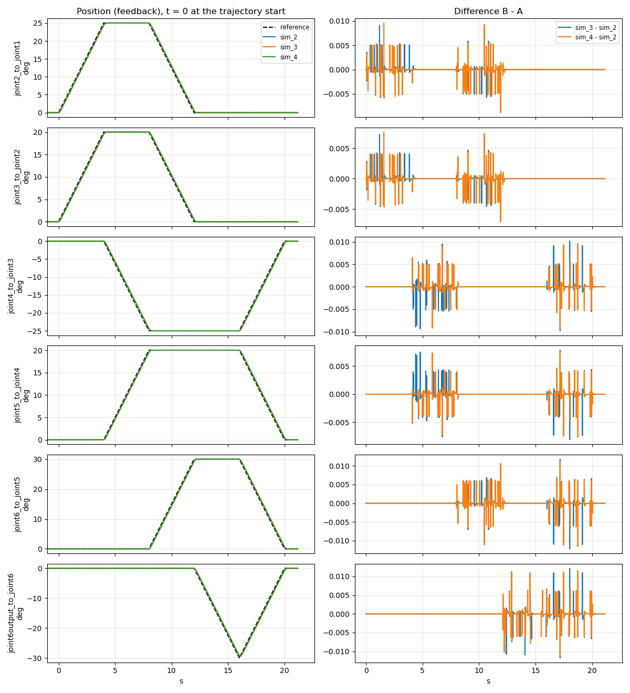

# Sim-to-real report v1: one trajectory in Gazebo and on the real arm (#37)

> **Draft.** The Gazebo part is measured (2026-11-10). The real arm part waits for the arm
> runs: every `TODO` below is filled from them.

## Verdict

TODO after the real runs: the worst joint and its gap (max and RMS, degrees), and whether that
gap is larger than the arm's own repeatability (real vs real).

Gazebo so far: three runs of the same trajectory differ by at most **0.01 deg** on every joint,
so the comparison method itself adds almost nothing. In Gazebo the joints follow the reference
about **90 ms late** (0.45 to 0.68 deg while moving) and end exactly on target.

## Results

All numbers in degrees, from `compare_runs.py`. "Noise floor" is the spread between runs of the
same world: a sim-to-real gap only means something where it is larger than the real-vs-real
spread.

### Real vs sim (feedback, real - sim)

TODO: `compare_runs.py runs/sim_2 runs/real_1 runs/real_2 runs/real_3`.

| Joint | max abs | mean abs | signed mean | RMS | final abs | real vs real, max abs |
|---|---:|---:|---:|---:|---:|---:|
| joint2_to_joint1 | | | | | | |
| joint3_to_joint2 | | | | | | |
| joint4_to_joint3 | | | | | | |
| joint5_to_joint4 | | | | | | |
| joint6_to_joint5 | | | | | | |
| joint6output_to_joint6 | | | | | | |

### Noise floor of Gazebo (sim vs sim)

`compare_runs.py runs/sim_2 runs/sim_3 runs/sim_4`, worst of the two pairs:

| Joint | max abs | mean abs | signed mean | RMS | final abs |
|---|---:|---:|---:|---:|---:|
| joint2_to_joint1 | 0.01 | 0.00 | 0.00 | 0.00 | 0.00 |
| joint3_to_joint2 | 0.01 | 0.00 | 0.00 | 0.00 | 0.00 |
| joint4_to_joint3 | 0.01 | 0.00 | -0.00 | 0.00 | 0.00 |
| joint5_to_joint4 | 0.01 | 0.00 | 0.00 | 0.00 | 0.00 |
| joint6_to_joint5 | 0.01 | 0.00 | 0.00 | 0.00 | 0.00 |
| joint6output_to_joint6 | 0.01 | 0.00 | 0.00 | 0.00 | 0.00 |

The 0.01 deg appears only while a joint moves, as single-sample spikes: the 10 ms stamps of two
runs never fall at exactly the same point of the motion. At rest the gap is 0.

### Tracking error (feedback - reference)

| Joint | Move | sim max abs | sim mean abs | real max abs | real mean abs |
|---|---|---:|---:|---:|---:|
| joint2_to_joint1 | 25 deg in 4 s | 0.56 | 0.21 | TODO | TODO |
| joint3_to_joint2 | 20 deg in 4 s | 0.45 | 0.17 | TODO | TODO |
| joint4_to_joint3 | 25 deg in 4 s | 0.56 | 0.21 | TODO | TODO |
| joint5_to_joint4 | 20 deg in 4 s | 0.45 | 0.17 | TODO | TODO |
| joint6_to_joint5 | 30 deg in 4 s | 0.68 | 0.26 | TODO | TODO |
| joint6output_to_joint6 | 30 deg in 4 s | 0.68 | 0.25 | TODO | TODO |

Sim values are the same in all three runs (to 0.01 deg).

**Gazebo lags by a constant 90 ms.** The error divided by the joint's speed is the same for every
joint: 0.68 / 7.5 deg/s = 0.56 / 6.25 = 0.45 / 5 = 0.09 s. Each joint moves 8 of the 21 s, and
its mean error is about 8/21 of its max, so the error is constant while moving and 0 at rest. The
final error is 0: Gazebo always reaches the target. This is a measurement of three runs, not yet
an explanation (candidates: the position command and the state read one or more control periods
apart, the physics step).

## Figures



Left: reference (dashed) and feedback of `sim_2`, `sim_3` and `sim_4`, with t = 0 at the
trajectory start. Right: `sim_3 - sim_2` and `sim_4 - sim_2`.

TODO: `figures/real_vs_sim.png`.

**The reference is straight lines.** The trajectory gives positions only, so the controller
interpolates linearly: constant speed between points, and a jump of speed at every point (4, 8,
12, 16 s). Two consequences:

- The peak speed is 1.0 x |dtheta| / dt, not the 1.9 x of a smooth curve that
  `run_trajectory.py` assumes. Its speed check is about twice as strict as needed, which is safe.
- A real servo cannot jump in speed. TODO: check whether the real tracking error peaks at the
  points.

## How this was produced

Tools and procedure: [`tools/README.md`](tools/README.md). Reproducible from the bags:

```bash
python3 docs/03_verification/sim_to_real/tools/compare_runs.py runs/sim_2 runs/sim_3 runs/sim_4 \
  --plot runs/sim_vs_sim.png
python3 docs/03_verification/sim_to_real/tools/compare_runs.py runs/real_1 runs/real_2 runs/real_3
python3 docs/03_verification/sim_to_real/tools/compare_runs.py runs/sim_2 runs/real_1 runs/real_2 \
  runs/real_3 --plot runs/real_vs_sim.png
```

Raw output of the sim vs sim comparison: TODO paste here, like the precedent
(`joint_states_rate/joint_states_rate.md`).

## Setup

| | Gazebo | Real arm |
|---|---|---|
| Date | 2026-11-10, 17:34 to 17:40 | TODO |
| Runs | `sim_1` to `sim_4`, `sim_99` (Ctrl-C test) | TODO `real_1` to `real_3` |
| Launch | `gazebo.launch.py` | `driver.launch.py` (serial backend) |
| Controller rate | 100 Hz (`ros2_controllers.yaml`) | 30 Hz (`jetson_controllers.yaml`) |
| Clock of the stamps | simulation time | the Jetson's clock |
| `ROS_DOMAIN_ID` | 18 | 17 |
| Commit | `fc928bc` | TODO |
| Trajectory | `tools/trajectory.yaml`, sha256 `f836e8d8...` | same file |
| Operator | Felipe Suassuna | TODO |
| Hand on the power plug | not needed | TODO |
| Image | `positronic-dev:jazzy` | TODO |
| Notes | | TODO: anything heard or seen (a clunk, a stall) |

The trajectory: home (all joints at 0), then every joint moves out by 20 to 30 deg and back,
up to three joints at once, one point every 4 s, 20 s in all. Highest peak 0.249 rad/s (14.3 deg/s),
under the 15 deg/s the real arm follows within `arm_controller`'s 5 deg trajectory tolerance
(#33). Every position at least 10 deg inside the URDF limits.

## What the sim runs found

- **A run must wait for data, not for topics.** The first sim run (2026-11-05) failed with
  `No /joint_states with every joint: cannot size the move to home.`: Gazebo was still loading,
  and its bag holds 1 `/joint_states` message in about 10 s. The topics existed, so the old
  check passed. `record_run.sh` now waits up to 30 s for one message on each topic.
- **Ctrl-C works in Gazebo** (`sim_99`): the goal is cancelled, the arm stops, the bag closes
  and the run is renamed `sim_99_FAILED`.
- **30 % of the URDF speed is too fast for the arm.** 0.785 rad/s is 45 deg/s, three times what
  #33 measured as the arm's working limit. `run_trajectory.py` caps every joint at 15 deg/s.

## Limits of the method

- **Alignment.** t = 0 is where the reference leaves home by 1e-4 rad, interpolated between two
  samples. It is as good as the stamps' jitter: within a few ms in Gazebo, TODO on the Jetson
  (33 ms period).
- **Linear interpolation** between samples, onto a 100 Hz grid. The Jetson's 30 Hz samples are
  further apart, so fast changes between two of them are smoothed.
- **Lost messages.** The recorder lost 2 messages on the transport layer in `sim_1` and in
  `sim_99` (of about 2900). Interpolation bridges them.
- **One trajectory, one speed.** The gap at other speeds or poses is not measured.
- TODO: the joint 6 zero offset, if it is still open
  (`docs/03_verification/joint6_zero/joint6_zero.md`).

## Safety

Gazebo: no hardware. Real arm: TODO, what moved, at what speed, who held the power plug, anything
that stopped a run.

## Next for #53

TODO: what the final report adds (more trajectories and speeds, the gripper, ...).
