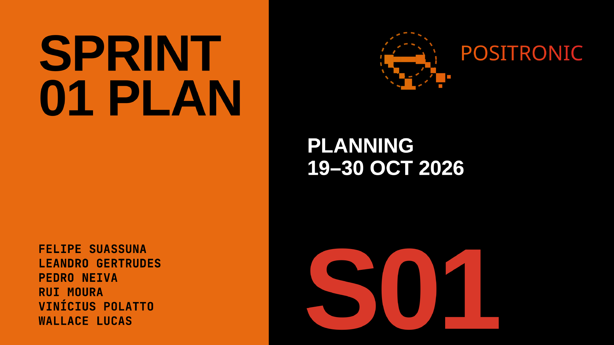
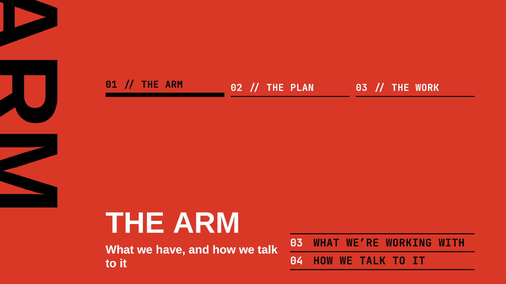
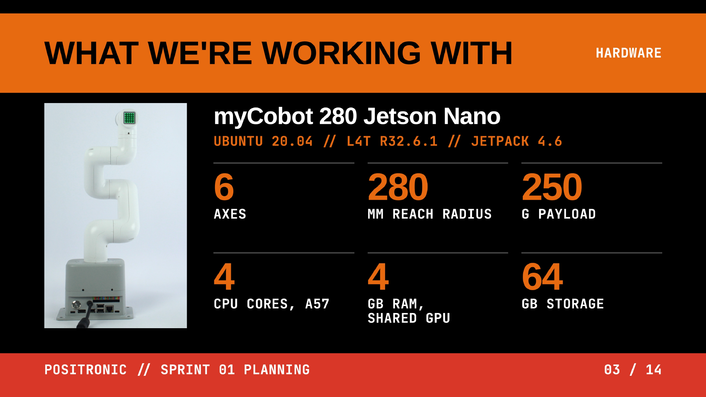

  

# 07 · Presentations — Sprint 1 — Planning

<!-- nav:auto -->

  <a href="../../../README.md"><b>Home</b></a> &nbsp;|&nbsp;
  <a href="../../sprint_00/review/README.md"><b>&#8592; Back</b></a> &nbsp;|&nbsp;
  <a href="../review/README.md"><b>Forward &#8594;</b></a>

Sprint planning presentation — **Mon 19 Oct 2026, 16:30** (Sprint 1 · M1).

Sprint goal: The real arm is visible in ROS 2 from any laptop, and every PR is built and tested by CI.

Source: `present.pdf` made on claude presentations feature.

## Embed the compiled PDF

## Slides

1. Cover — Sprint 01 Plan
2. 01 — The Arm (divider)
3. What We're Working With
4. How We Talk To It
5. 02 — The Plan (divider)
6. Sprint Goal
7. Goals && Done When
8. The Path
9. 03 — The Work (divider)
10. How We Will Work
11. Our Kanban
12. Git in Practice
13. ROS 2 Lint
14. Q&A (full-page slide)

## References

- [Sprint 1 plan](../../../06_project_management/sprints/01_sprint.md)
- [Serial protocol](../../../00_specs/hardware/07_serial_protocol.md) · [Command reference](../../../00_specs/hardware/08_command_reference.md)

<!-- nav:auto -->

  <a href="#top"><b>Top</b></a>

