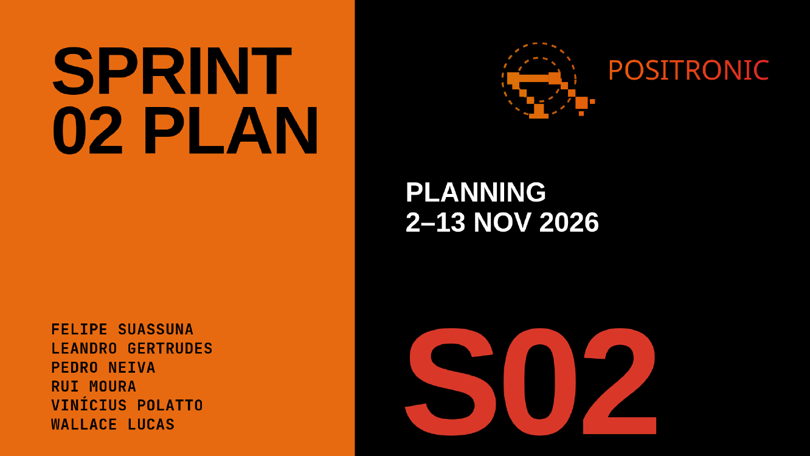
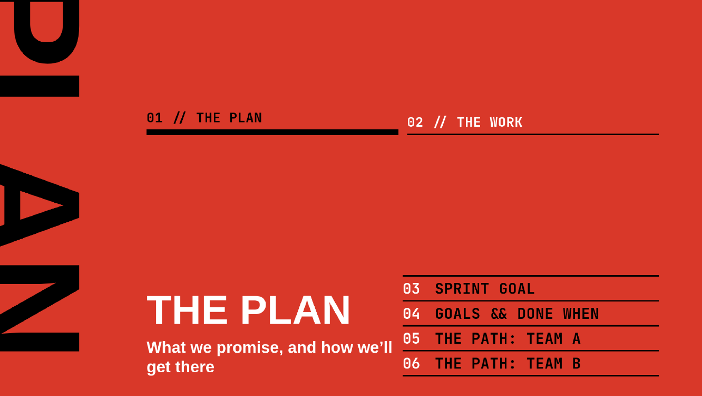
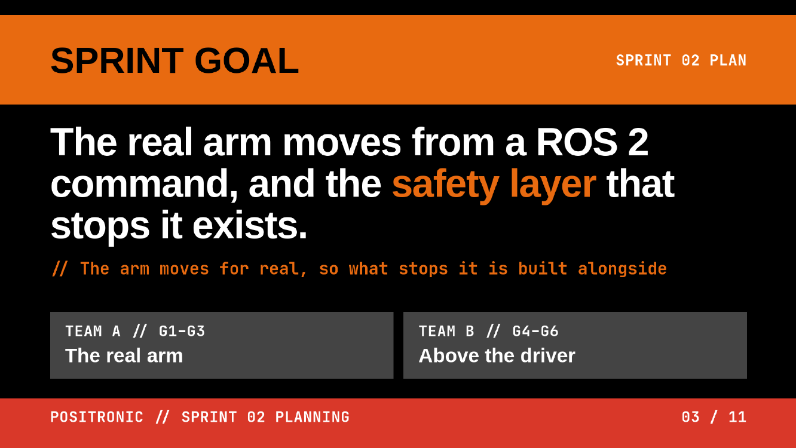
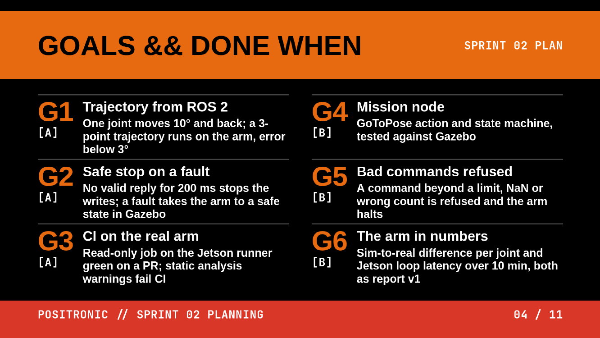
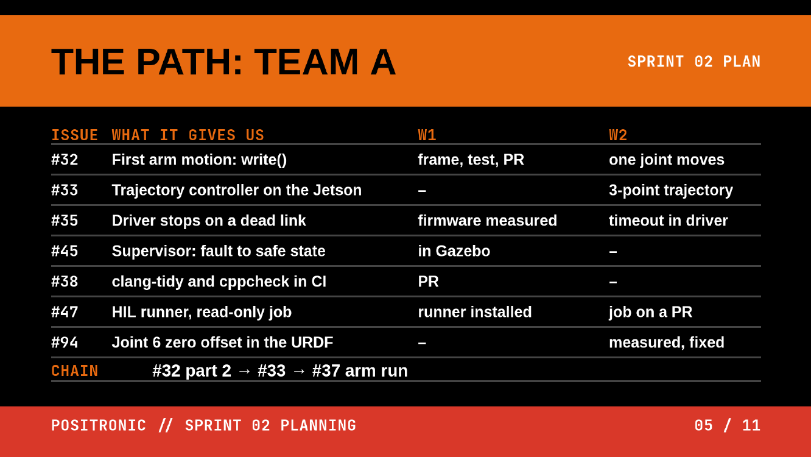
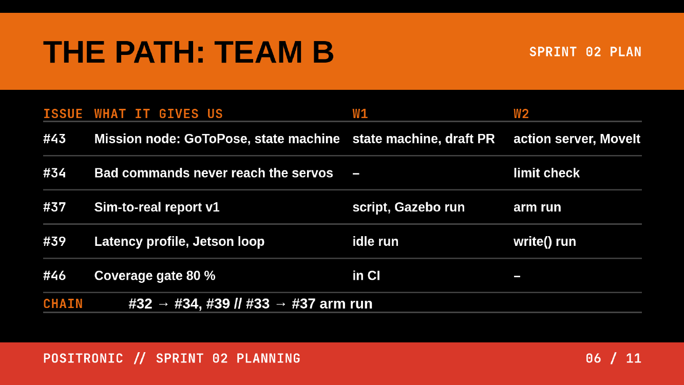
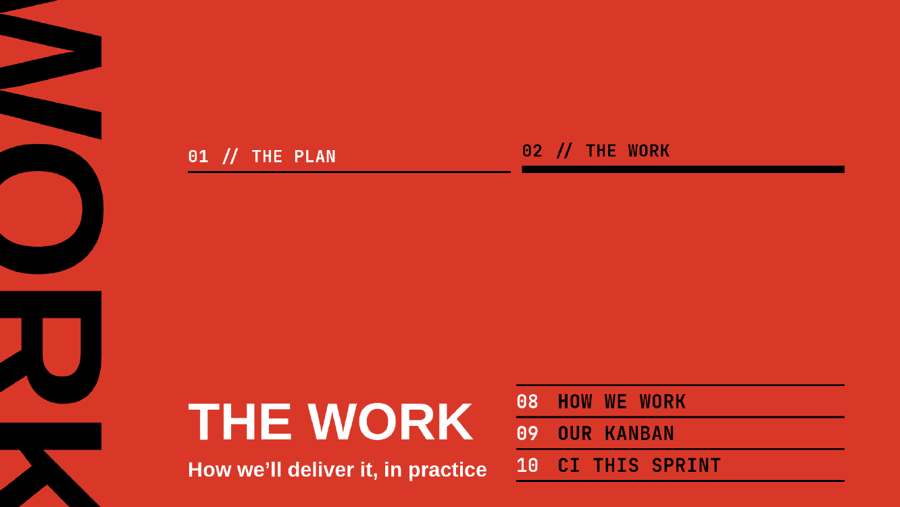
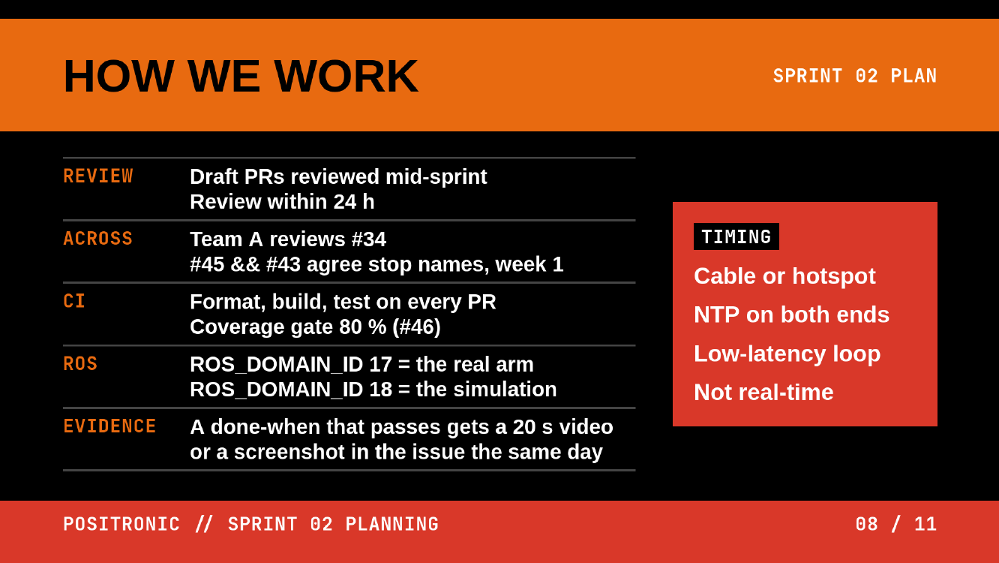
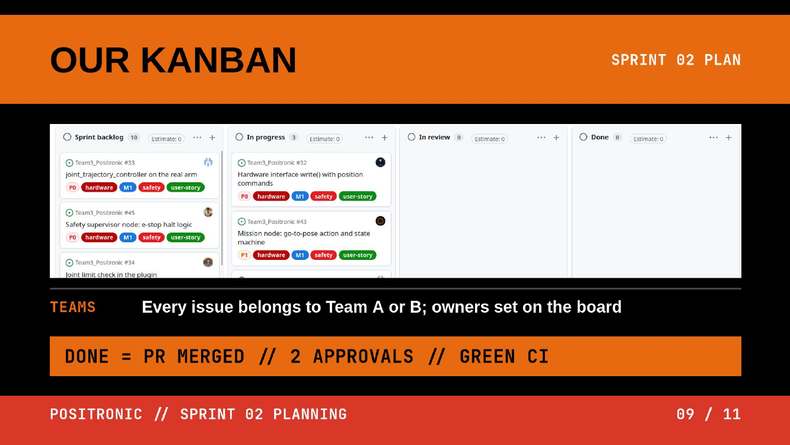
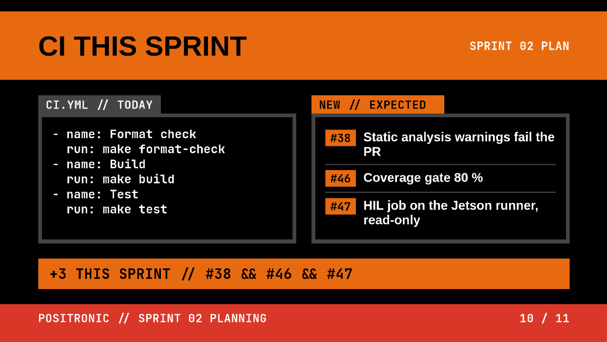

  

# 07 · Presentations — Sprint 2 — Planning

<!-- nav:auto -->

  <a href="../../../README.md"><b>Home</b></a> &nbsp;|&nbsp;
  <a href="../../sprint_01/planning/README.md"><b>&#8592; Back</b></a> &nbsp;|&nbsp;
  <a href="../review/README.md"><b>Forward &#8594;</b></a>

Sprint planning presentation — **Mon 2 Nov 2026, 10:00** (Sprint 2 · M1).

Sprint goal: the real arm moves from a ROS 2 command, and the safety layer that stops it exists.

Source: `present.pdf` made on the Claude presentations feature.

## Embed the compiled PDF

## Slides

1. Cover — Sprint 02 Plan
2. The Plan && The Work (section index)
3. Sprint Goal
4. Goals && Done When
5. The Path: Team A
6. The Path: Team B
7. The Work (divider)
8. How We Work
9. Our Kanban
10. CI This Sprint
11. Q&A (full-page slide)

## References

- [Sprint 2 plan](../../../06_project_management/sprints/sprint_02.md)

<!-- nav:auto -->

  <a href="#top"><b>Top</b></a>

