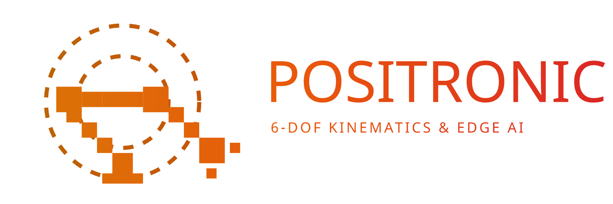
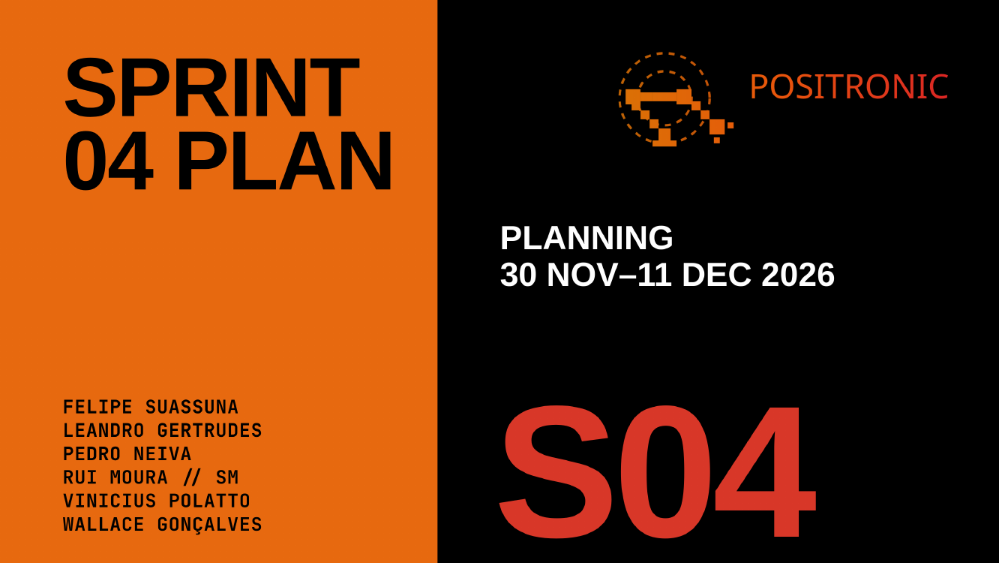
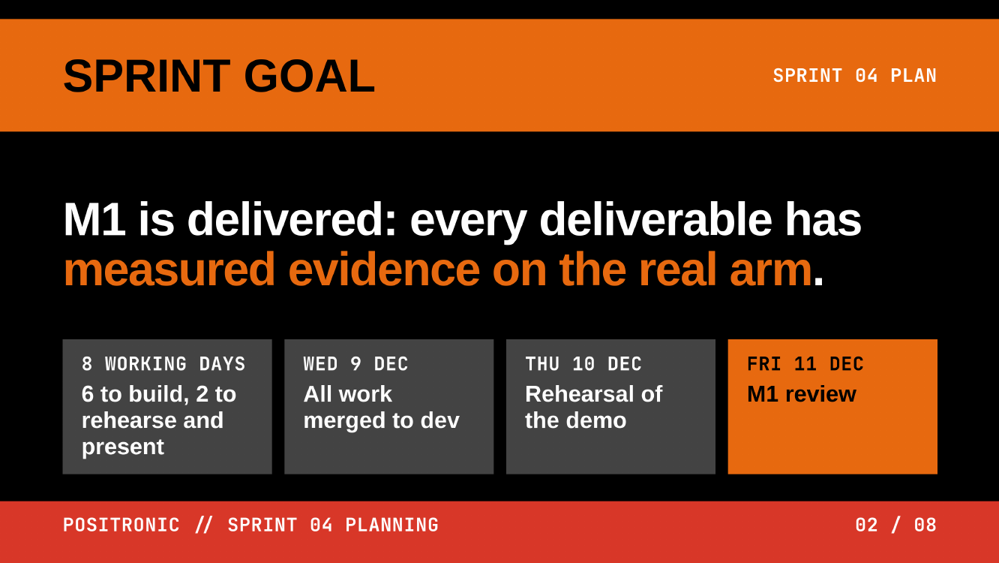
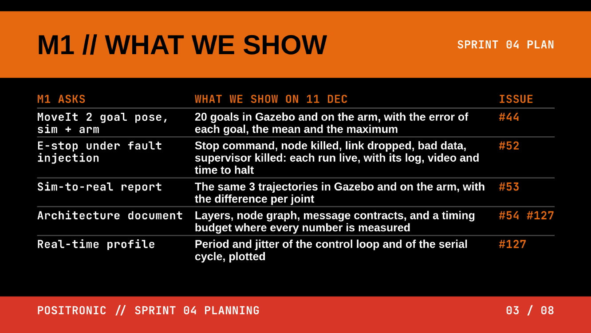
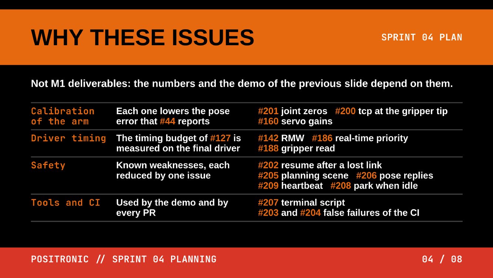
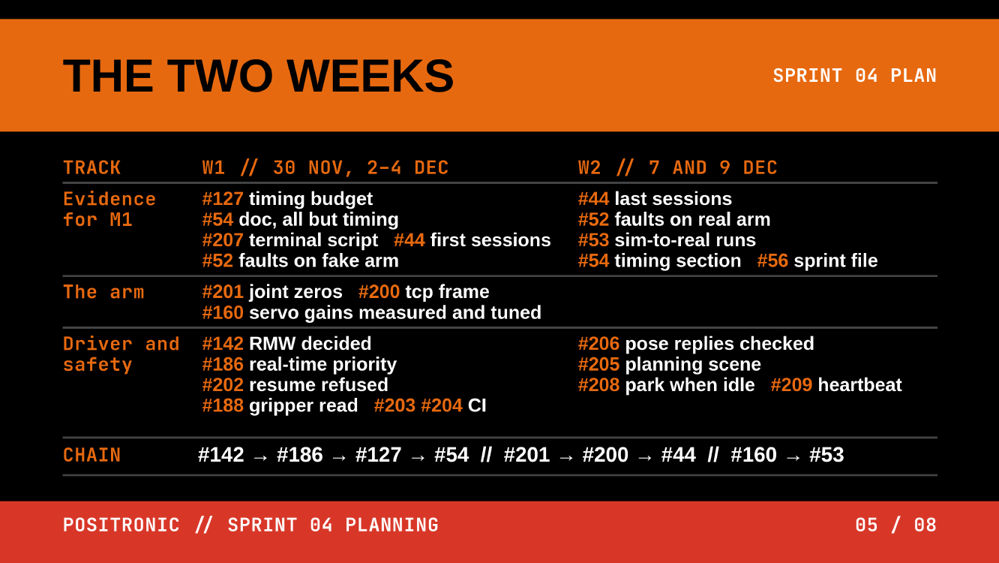
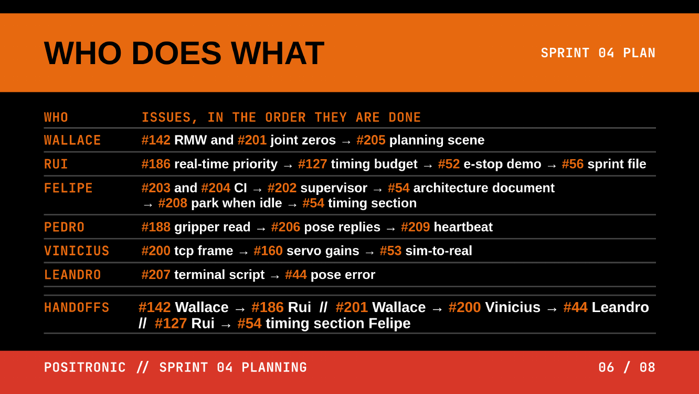
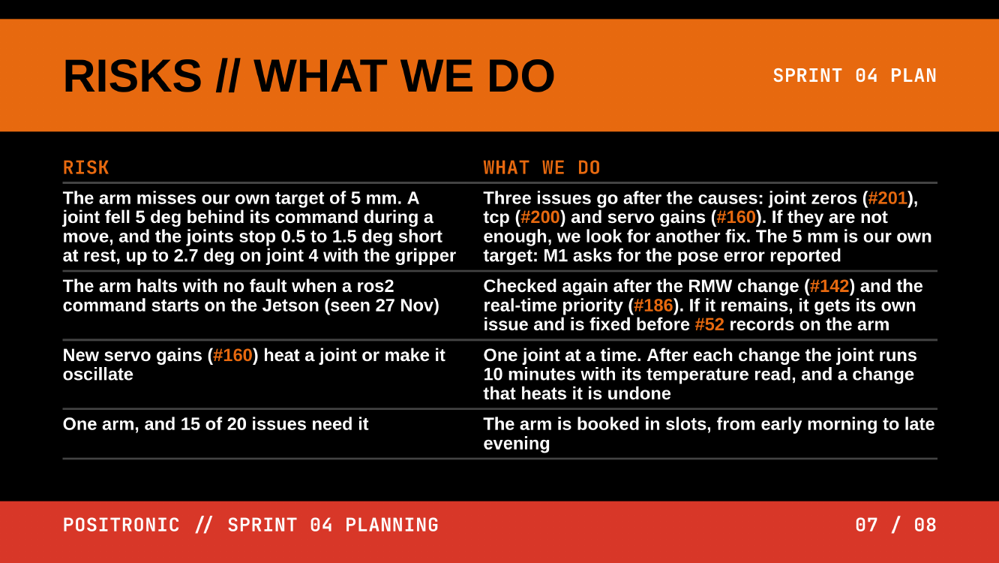
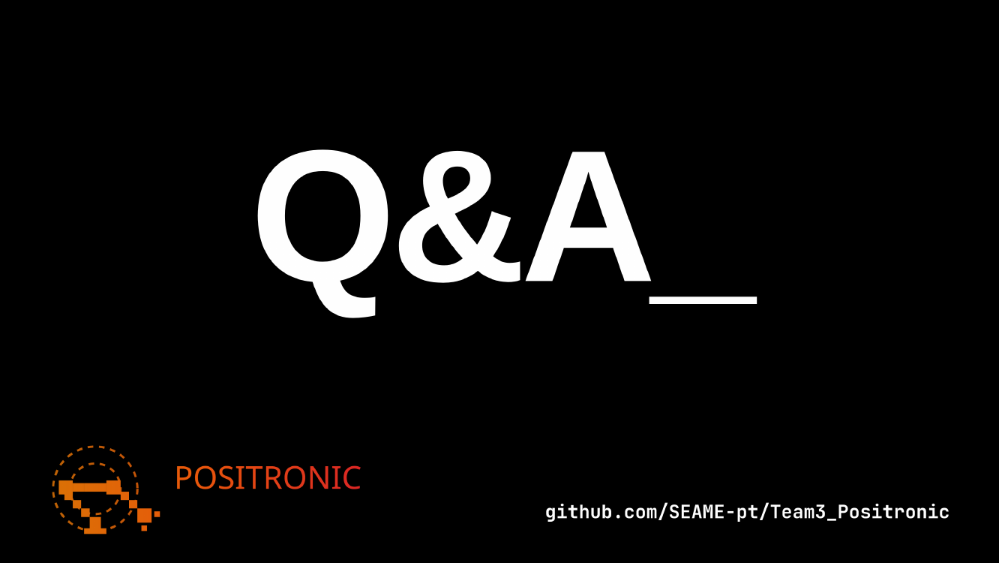

  

# 07 · Presentations — Sprint 4 — Planning

<!-- nav:auto -->

  <a href="../../../README.md"><b>Home</b></a> &nbsp;|&nbsp;
  <a href="../../sprint_02/review/README.md"><b>&#8592; Back</b></a> &nbsp;|&nbsp;
  <a href="#top"><b>Forward &#8594;</b></a>

Sprint planning presentation, **Fri 27 Nov 2026** (Sprint 4, M1). The sprint runs from 30 Nov to
11 Dec 2026.

Sprint goal: M1 is delivered: every deliverable has measured evidence on the real arm.

Source: `present.pdf`.

## Embed the compiled PDF

## Slides

1. Cover: Sprint 04 Plan
2. Sprint Goal
3. M1: What We Show
4. Why These Issues
5. The Two Weeks
6. Who Does What
7. Risks: What We Do
8. Q&A

<!-- nav:auto -->

  <a href="#top"><b>Top</b></a>

